# WEEK 09 실습 2 · 최종 실습 보고서

**검색·정렬·페이지네이션 게시판 개선하기**

| 구분 | 내용 |
|---|---|
| 과목 | 웹서비스설계 |
| 소속 | 컴퓨터인공지능학부 |
| 학번 | 202346113 |
| 이름 | 송세화 |
| 작성·검증 기준일 | 2026년 11월 14일 (KST) |
| 제출일 | 2026년 11월 15일 |
| 제출물 | GitHub 저장소, 본 보고서 및 테스트 캡처 |
| 저장소 | https://github.com/sehwa-song/week09-board-improvement |

## 1. 실습 목표와 근거 범위

본 실습은 원본 게시판의 검색·정렬·페이지네이션·비동기 요청·URL 복원 기능을 검증하고, 발견한 문제를 개선한 뒤 결과를 근거와 함께 설명하는 데 목적이 있다. 수행 절차는 기능 검증 → 코드 개선 → 결과 설명으로 구성하였다.

평가 영역은 검색·정렬 25점, 페이지네이션 35점, 비동기 처리 30점, URL 상태 복원 10점이다. 배점은 인수인계서 기준이며 별도 과제 지시문은 현재 저장소에 없어 독립 대조하지 못했다. 본 보고서는 점수를 임의 산정하지 않는다.

근거는 현재 server.js·index.html·package.json·package-lock.json, 원본 커밋 d3db504와 개선 이력, 보존된 [캡쳐기록.md](./캡쳐기록.md), 사용자 촬영 PNG 42장이다. 제출자 제공 인적사항을 표지에 반영했다. 사진은 원본 상태로 삽입했으며 새 화면이나 허위 캡처를 만들지 않았다.

브라우저 직접 검증은 기존 기록·캡처에 근거한다. 문서 작성 과정의 추가 검증은 현재 서버 처리 함수를 프로세스 안에서 실행한 보조 확인이며, 실제 HTTP 전송·브라우저 조작·새 사용자 촬영과 구분한다. 각 사진은 촬영 시점의 상태를 나타내므로 최종 구현과 다를 수 있다.

## 2. 개발 환경과 구조

| 구분 | 확인 내용 |
|---|---|
| 서버 | Node.js, Express; 문서 점검 시 Node.js 24.21.0·Express 5.3.0 |
| 화면 | 단일 index.html, HTML/CSS/JavaScript, fetch |
| 검증 도구 | 기존 Chrome DevTools Network·Console, 3G 및 No throttling |
| 데이터 | 실행 시 생성하는 인메모리 게시글 1,000개, 기본 조회 10개 |
| 실제 DB | 사용하지 않음 |
| 서버 주소 | http://localhost:3000 |

```text
index.html: 입력·정렬·페이지 상태 → fetch 요청
    ↕ HTTP / JSON ({ items, meta })
server.js: 검색 filter → 정렬 sort 또는 커서 filter → slice
    ↕
POSTS: 메모리 배열 1,000개 (ID 1000부터 1까지)
```

```text
실습코드/
├── README.md
├── server.js
├── index.html
├── package.json / package-lock.json
└── docs/
    ├── 캡쳐기록.md              # 기존 증거, 보존
    ├── 최종실습보고서.md        # 본 보고서
    ├── 최종실습보고서.pdf
    └── images/                 # 직접 촬영한 PNG 42개
```

```bash
npm install
node server.js
```

실행 후 브라우저에서 localhost:3000에 접속한다. node_modules는 Git에서 제외하고 package 파일과 lock을 유지한다. npm start 스크립트는 없으며 서버는 3000번 포트를 사용한다. 조회수는 실행마다 무작위 생성되므로 캡처 수치와 재실행 수치가 다를 수 있다.

화면 SQL 패널은 프론트엔드가 생성하는 설명용 문자열이다. 실제 데이터베이스 쿼리·인덱스 탐색·SQL 파라미터 바인딩은 수행하지 않는다. 실행 시간 수치로 실제 DB 성능이나 O(log N)을 입증할 수 없다.

## 3. 기존 기능 검증 결과

아래 표는 원본 및 단계별 개선 당시의 직접 검증 결과를 요약한다. 최초 판정이 개선 필요였던 항목은 5장의 개선 코드 및 후속 사진과 연결한다. 기존 ID 기준 latest에서 얻은 목록을 최종 날짜 기준 결과로 혼용하지 않는다.

| 테스트 입력·조건 | 기대 결과 | 당시 실제 결과 | 판정·근거 |
|---|---|---|---|
| 기본 화면 | 목록·요청·응답 정상 | 그림 1은 30페이지·10개 표시 | 구동 확인, 최초 1페이지는 사진 미입증 |
| 제목 B-Tree | 제목 포함 결과 | 84건, 10개씩 9페이지 | 성공, 2·17 |
| 본문 상세 본문 | 본문 포함 결과 | 1,000건·100페이지 | 성공, 4·기록 |
| 없는 검색어 | items=[], 전체 0 | 빈 안내, totalPages=1, 양방향 false | 성공, 3 |
| latest / oldest | 날짜 DESC / ASC | ID만 정렬, 날짜 순서 불일치 | 개선 필요, 5·6 |
| views 동점 | views DESC, id DESC | 5,009회 ID 893→235→219 | 성공, 7 |
| sort=invalid | latest 기본값 | 원본 ID 기준 정상 응답 | 성공, 8 |
| sort=__proto__ | 상속 속성 거부 | TypeError 발생 | 개선 필요, 9 |
| sort=constructor | 상속 함수 거부 | 정상처럼 보이나 상속 함수 선택 가능 | 소스 기준 개선 필요, 10 |
| page=0 / -1 / abc | 1로 보정 | meta.page=1 | 성공, 11~13 |
| limit=1000 | 최대 100개 | limit=100, totalPages=10 | 성공, 14 |
| 오프셋 2페이지 | offset=10 | 원본 ID 990~981, 양방향 true | 성공, 15 |
| 마지막 100페이지 | offset=990, 다음 없음 | 원본 ID 10~1, hasNext=false | 성공, 16 |
| 검색·정렬 변경 | 1페이지 초기화 | 검색어 유지·페이지 재계산 | 성공, 17·18 |
| 커서 첫 조회 | 1000~991, nextCursor=991 | 10개·hasNext=true | 조회 성공, 정렬 UI 개선 필요, 19 |
| cursor=991 더 보기 | 990~981 추가 | nextCursor=981, 20개 누적 | 성공, 20 두 장 |
| cursor=11 | 10~1, 다음 없음 | nextCursor=1, hasNext=false | 성공, 21 |
| 마지막 상황 재현 | 종료 버튼 | DevTools 설정 후 종료 문구·disabled 로직 | 해당 상황 성공, 22 |
| 커서 없는 검색어 | 빈 목록 | search 미전달, 전체 첫 목록 반환 | 개선 필요, 23 |
| 수동 b-tree 입력 | 300ms 미만 연속 시 1회 | 5건, 입력 간격 미확인 | 판정 보류, 24 |
| 3G B-Tree→Redis | 이전 취소·최신 결과 | canceled·최종 redis 200·취소 로그 | 관찰 시나리오 성공, 25 두 장 |
| redis·views·page=2 새로고침 | URL과 화면 복원 | 입력·선택·페이지·목록 일치 | 성공, 26 |
| B-Tree로 변경 후 뒤로 가기 | 이전 상태 복원 | redis·views·2페이지 복원 | 성공, 27 |

## 4. 발견한 문제와 원인

첫째, latest와 oldest가 ID만 비교하여 실제 작성일과 일치하지 않았다. ID의 크기가 작성일의 순서와 같다는 가정이 생성 데이터에서 성립하지 않았다.

둘째, 정렬 키를 일반 객체의 대괄호 접근과 참/거짓 판정만으로 선택하여 상속 속성까지 허용했다. __proto__는 객체가 비교 함수로 들어가 TypeError를 일으켰고, constructor는 상속 함수여서 표면상 정상 응답만으로 문제를 찾기 어려웠다.

셋째, 커서 검색은 프론트엔드의 search 전달과 백엔드 필터가 모두 빠져 있었다. 검색창에 없는 검색어를 넣어도 ID 1000부터의 일반 목록이 반환되었다.

넷째, 커서 API는 ID 내림차순인데 날짜순·조회수순 메뉴가 표시되어 실제 적용 기준을 오해할 수 있었다. 커서 모드의 주소창에도 오프셋 쿼리가 남았다.

다섯째, 디바운스 수동 테스트의 입력 간격이 통제되지 않았다. 5건의 요청을 디바운스 오류로 단정할 수 없어 검증 방법을 보완했다.

## 5. 직접 코드 개선과 전후 검증

원본 커밋은 d3db504, 원본 검증 기록은 0c05ba2다. 개선은 3144d29(정렬 키), 19b3efc(날짜 정렬), f5ff3c8(커서 검색·UI)에 반영되어 있다. 이번 문서화에서는 해당 기능 코드를 추가 수정하지 않았다.

### 5.1 정렬 화이트리스트 상속 속성 차단

원본 코드는 다음과 같다.

```javascript
const sortComparator = SORT_WHITELIST[sortKey] || SORT_WHITELIST.latest;
```

문제 원인은 직접 정의된 속성과 상속 속성을 구분하지 않은 데 있다. Object.freeze()는 객체 변경을 막지만 상속 속성 조회를 차단하지 않는다. 수정 후에는 자료형과 직접 정의 여부를 함께 확인한다.

```javascript
const sortComparator =
  typeof sortKey === 'string' &&
  Object.hasOwn(SORT_WHITELIST, sortKey)
    ? SORT_WHITELIST[sortKey]
    : SORT_WHITELIST.latest;
```

이 변경은 허용 키 latest·oldest·views만 비교 함수로 선택한다. 실제 SQL 실행이 없으므로 SQL Injection 전체를 원천 봉쇄했다는 결론으로 확대하지 않는다. 아래 사진 28·29는 날짜 정렬 개선 이전 단계이므로 원본 ID 순서가 보이는 것이며, 최종 구현의 latest는 날짜 우선이다.

### 그림 9. 개선 전 __proto__ 오류

검증 목적: 상속 속성의 정렬 함수 선택 차단 여부 확인.

| 기대 결과 | 실제 결과 | 판정 |
|---|---|---|
| latest로 대체하고 정상 JSON 반환 | 객체가 비교 함수로 선택되어 Array.sort TypeError가 발생했다. 오류 화면에는 로컬 사용자 경로도 포함된다 | 개선 필요 → 그림 28에서 재검증 |

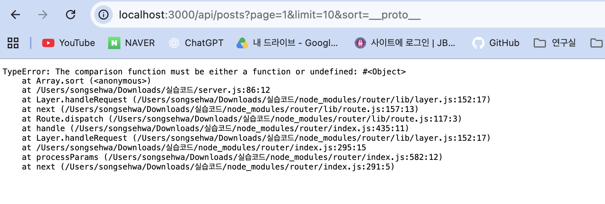

*그림 9. 개선 전 __proto__ 오류. 제출자가 직접 촬영한 원본 캡처.*

### 그림 28. 개선 후 __proto__ 정상 응답

검증 목적: 상속 속성 대체 처리 확인.

| 기대 결과 | 실제 결과 | 판정 |
|---|---|---|
| TypeError 없이 latest 정상 JSON | 화이트리스트 개선 직후 정상 JSON을 확인했다. 이 사진은 날짜 정렬 개선 전이므로 ID 1000~991이다 | 성공 / 최종 날짜 기준 대체는 처리 함수 검증으로 보완 |

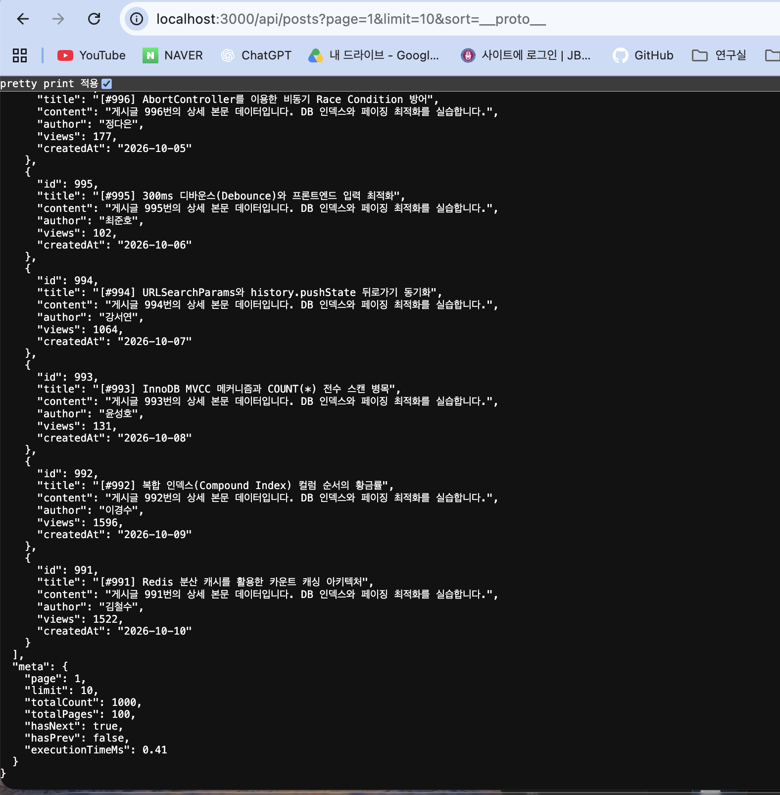

*그림 28. 개선 후 __proto__ 정상 응답. 제출자가 직접 촬영한 원본 캡처.*

### 그림 10. 개선 전 constructor

검증 목적: 상속된 함수 선택 여부 확인.

| 기대 결과 | 실제 결과 | 판정 |
|---|---|---|
| 상속 속성을 거부하고 latest 사용 | 정상 JSON·ID 내림차순처럼 보이지만 원본 속성 접근은 상속된 Object 생성자를 선택할 수 있다. 정상처럼 보이는 사진만으로 차단을 입증할 수 없다 | 소스 기준 개선 필요 → 그림 29와 개선 코드 대조 |

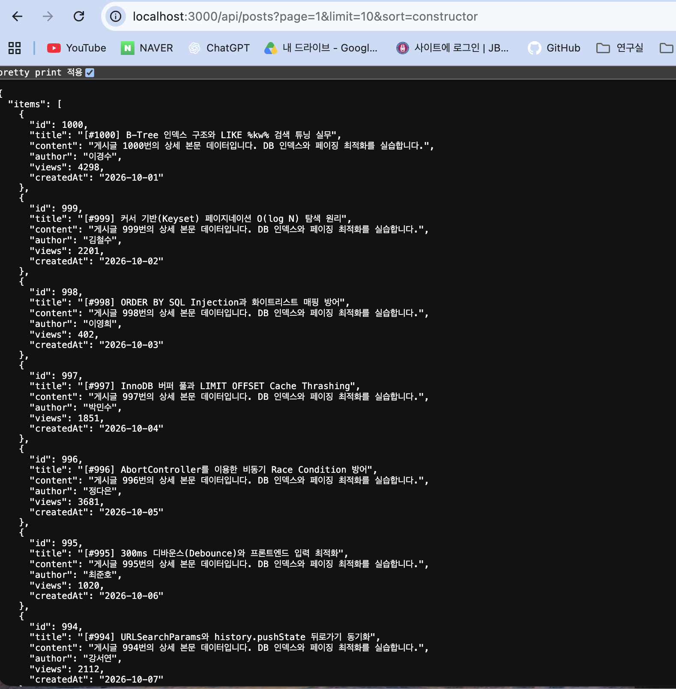

*그림 10. 개선 전 constructor. 제출자가 직접 촬영한 원본 캡처.*

### 그림 29. 개선 후 constructor 정상 응답

검증 목적: 정상 응답과 허용 키 검사 대조.

| 기대 결과 | 실제 결과 | 판정 |
|---|---|---|
| 상속 함수를 선택하지 않고 latest 사용 | 날짜 정렬 개선 전 정상 응답이다. Object.hasOwn() 변경 근거와 함께 판정하며 사진만으로 차단 성공을 단정하지 않는다 | 소스·응답 대조 성공 |

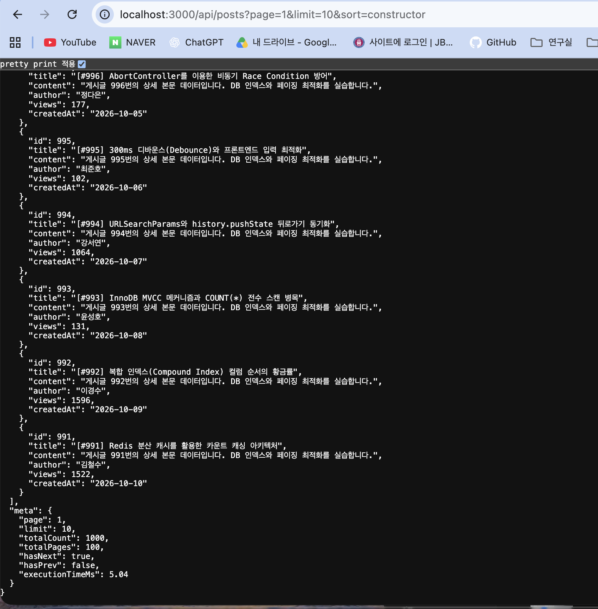

*그림 29. 개선 후 constructor 정상 응답. 제출자가 직접 촬영한 원본 캡처.*

결과 분석: __proto__ 오류는 정상 JSON 응답으로 바뀌었다. constructor는 수정 전에도 JSON이 정상이므로 사진 한 장의 외형만으로 차단 효과를 입증할 수 없다. 현재 소스의 Object.hasOwn() 조건과 최종 처리 함수에서 latest와 같은 ID 순서를 반환하는 보조 검증을 함께 근거로 사용했다.

### 5.2 작성일 기준 최신순·오래된순

원본은 ID만 비교하였다.

```javascript
latest: (a, b) => b.id - a.id,
oldest: (a, b) => a.id - b.id
```

작성일은 YYYY-MM-DD의 고정 길이 형식이므로 문자열 비교로 날짜 순서를 맞출 수 있다. 개선 후에는 작성일을 우선 비교하고 같으면 ID를 2차 기준으로 사용한다.

```javascript
latest: (a, b) =>
  b.createdAt.localeCompare(a.createdAt) || b.id - a.id,
oldest: (a, b) =>
  a.createdAt.localeCompare(b.createdAt) || a.id - b.id
```

조회수순의 views DESC·id DESC는 원본 기능을 유지하였다.

### 그림 5. 개선 전 최신순

검증 목적: latest가 작성일 내림차순인지 확인.

| 기대 결과 | 실제 결과 | 판정 |
|---|---|---|
| createdAt DESC, 동일 날짜 id DESC | ID 1000~991이지만 작성일은 2026-10-01~10-10으로 증가한다 | 개선 필요 → 그림 30에서 재검증 |

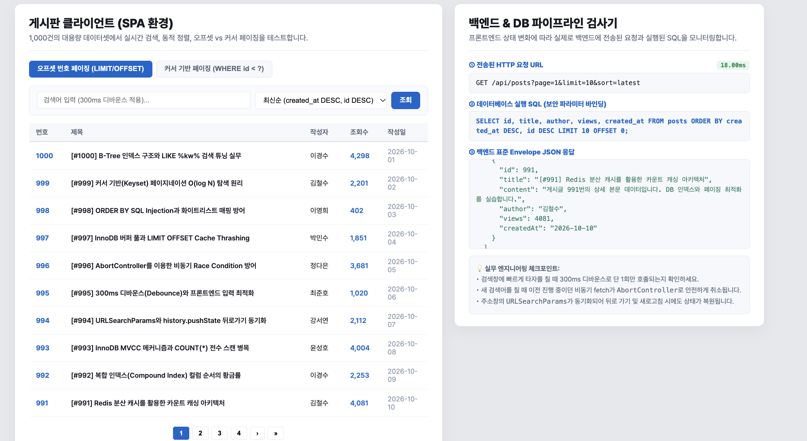

*그림 5. 개선 전 최신순. 제출자가 직접 촬영한 원본 캡처.*

### 그림 30. 개선 후 최신순

검증 목적: 날짜 우선 및 동일 날짜 ID 정렬 검증.

| 기대 결과 | 실제 결과 | 판정 |
|---|---|---|
| createdAt DESC, id DESC | 2026-10-28의 ID 973→945→917→889→861 뒤에 10-27의 974→946→918→890→862가 표시된다 | 성공 |

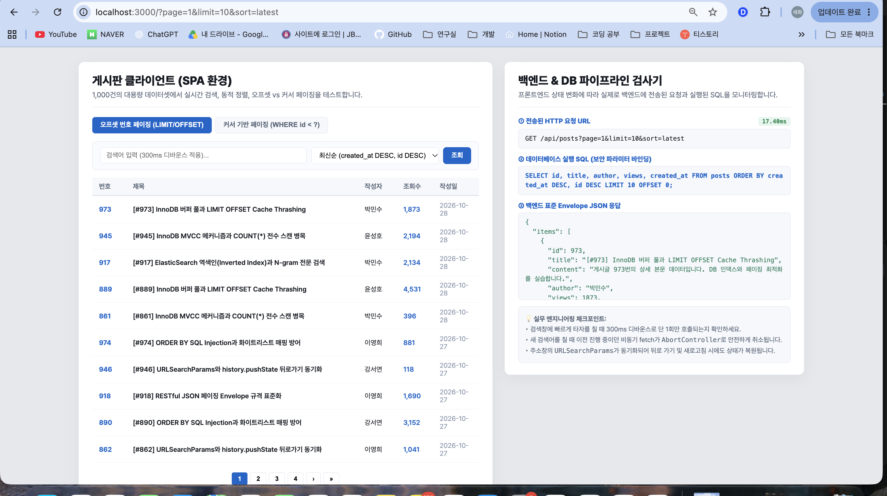

*그림 30. 개선 후 최신순. 제출자가 직접 촬영한 원본 캡처.*

### 그림 6. 개선 전 오래된순

검증 목적: oldest가 작성일 오름차순인지 확인.

| 기대 결과 | 실제 결과 | 판정 |
|---|---|---|
| createdAt ASC, 동일 날짜 id ASC | ID 1~10이지만 작성일은 2026-04-20~04-11로 감소한다 | 개선 필요 → 그림 31에서 재검증 |

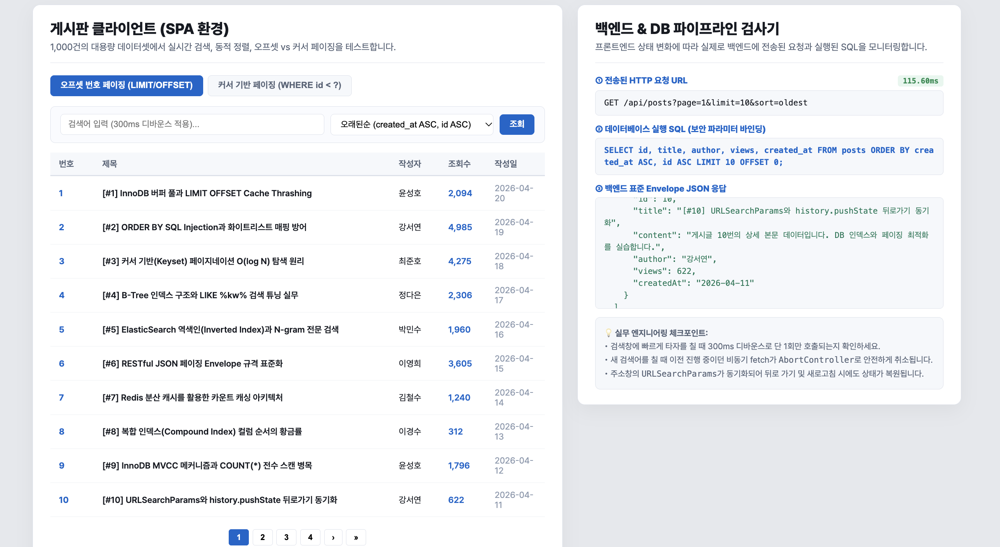

*그림 6. 개선 전 오래된순. 제출자가 직접 촬영한 원본 캡처.*

### 그림 31. 개선 후 오래된순

검증 목적: 날짜 오름차순과 동점 ID 검증.

| 기대 결과 | 실제 결과 | 판정 |
|---|---|---|
| createdAt ASC, id ASC | 2026-04-01의 ID 20→48→76, 04-02의 19→47→75 순서로 표시된다 | 성공 |

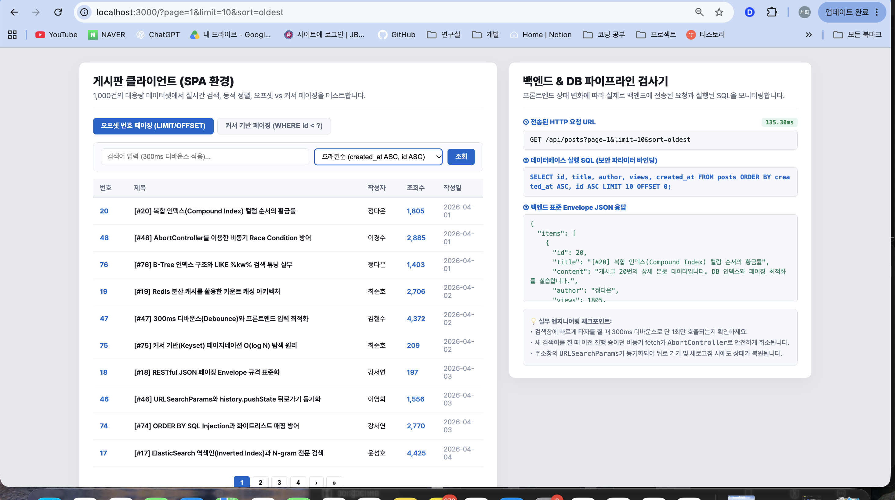

*그림 31. 개선 후 오래된순. 제출자가 직접 촬영한 원본 캡처.*

결과 분석: 최신순 첫 날짜는 2026-10-28, 오래된순 첫 날짜는 2026-04-01이다. 동일 날짜의 ID 방향도 각각 내림차순·오름차순이다. 최종 처리 함수 보조 검증에서도 전체 1,000건을 세 정렬 기준별로 비교하여 순서가 일치함을 확인했다.

### 5.3 커서 API 검색과 화면 연동

원본 백엔드는 검색 없이 커서만 필터링했다.

```javascript
let candidate = POSTS;
if (!isNaN(rawCursor) && rawCursor > 0) {
  candidate = POSTS.filter(p => p.id < rawCursor);
}
```

원본 프론트엔드도 limit와 cursor만 전달했다. 두 계층을 함께 수정해야 검색이 실제 적용된다. 현재 백엔드의 핵심 코드는 다음과 같다.

```javascript
const search = typeof req.query.search === 'string'
  ? req.query.search.trim().toLowerCase()
  : '';
let candidate = POSTS;
if (search) {
  candidate = candidate.filter(p =>
    p.title.toLowerCase().includes(search) ||
    p.content.toLowerCase().includes(search)
  );
}
if (!isNaN(rawCursor) && rawCursor > 0) {
  candidate = candidate.filter(p => p.id < rawCursor);
}
const sliced = candidate.slice(0, limit + 1);
const hasNext = sliced.length > limit;
const items = hasNext ? sliced.slice(0, limit) : sliced;
const nextCursor = items.length > 0 ? items[items.length - 1].id : null;
```

프론트엔드는 커서 URL에도 검색 조건을 추가한다.

```javascript
const q = new URLSearchParams({ limit: state.limit });
if (state.search) q.set('search', state.search);
if (state.cursor) q.set('cursor', state.cursor);
endpoint = `/api/posts/cursor?${q.toString()}`;
```

위 프론트엔드 발췌는 줄바꿈과 주석을 줄인 핵심 로직이다. 검색 이벤트의 기존 state.page=1·state.cursor=null 초기화와, 응답 처리의 기존 배열 초기화를 활용한다. 검색을 바꾸는 즉시 배열을 지운다고 표현하지 않고, 새 검색 응답을 누적하기 전에 배열을 비운다는 실제 순서를 따른다.

```javascript
if (!state.cursor) cursorPosts = [];
cursorPosts = [...cursorPosts, ...json.items];
state.cursor = json.meta.nextCursor;
state.hasNext = json.meta.hasNext;
```

API는 ID 내림차순 고정이며 날짜순·조회수순 커서를 구현한 것이 아니다. POSTS의 생성 순서가 ID 내림차순이고 filter·slice가 이 순서를 보존한다.

### 그림 23. 개선 전 커서 검색 누락

검증 목적: 없는 검색어가 커서 요청에 적용되는지 확인.

| 기대 결과 | 실제 결과 | 판정 |
|---|---|---|
| search 전달 후 빈 목록 | 없는 검색어를 입력해도 요청은 limit=10뿐이며 ID 1000~991이 표시된다 | 개선 필요 → 그림 33 |

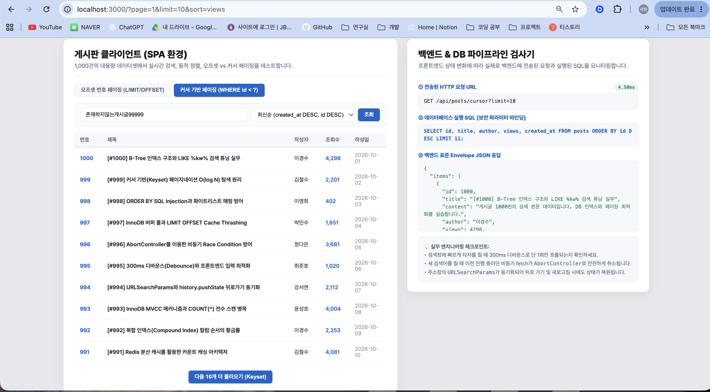

*그림 23. 개선 전 커서 검색 누락. 제출자가 직접 촬영한 원본 캡처.*

### 그림 33. 개선 후 커서 빈 검색 결과

검증 목적: 프론트엔드 검색어 전달·빈 결과 연동.

| 기대 결과 | 실제 결과 | 판정 |
|---|---|---|
| search 포함, items=[], nextCursor=null, hasNext=false | 빈 목록 안내와 종료 문구, 빈 JSON 결과가 표시된다 | 성공 |

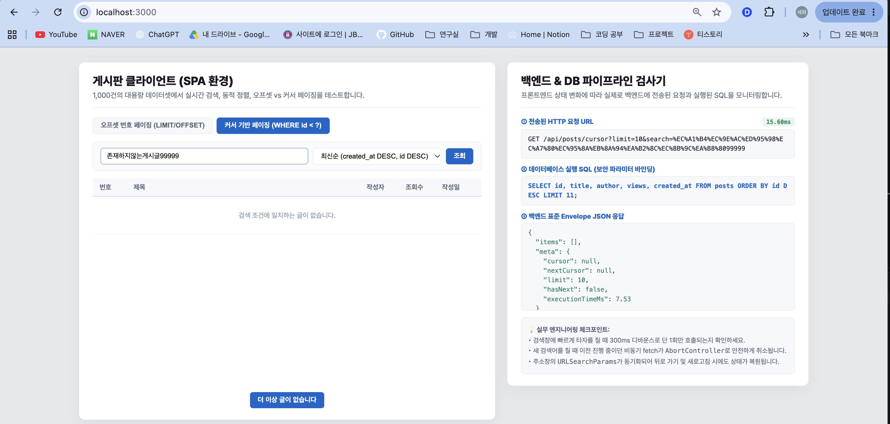

*그림 33. 개선 후 커서 빈 검색 결과. 제출자가 직접 촬영한 원본 캡처.*

### 그림 32. 커서 제목 검색 API

검증 목적: 백엔드 검색 필터와 다음 커서 검증.

| 기대 결과 | 실제 결과 | 판정 |
|---|---|---|
| B-Tree 결과 10개, nextCursor=892 | 사진에 검색된 결과의 후반부 ID 952→940→928→916→904→892와 응답 메타가 보인다. 첫 페이지 전체 순서는 그림 34·처리 함수 검증으로 보완했다 | 성공 |

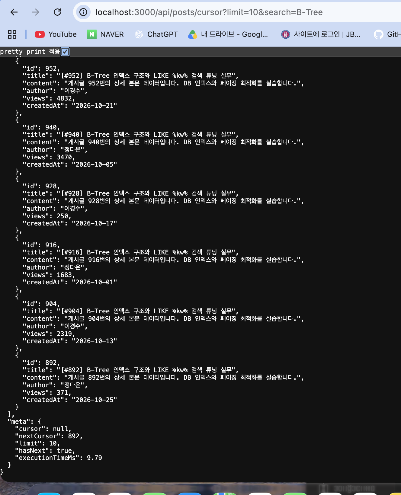

*그림 32. 커서 제목 검색 API. 제출자가 직접 촬영한 원본 캡처.*

### 그림 34. 검색 변경 후 누적 목록 초기화

검증 목적: 기존 커서 목록이 새 검색에 섞이는지 확인.

| 기대 결과 | 실제 결과 | 판정 |
|---|---|---|
| 새 검색은 cursor 없이 시작하고 새 10개 표시 | B-Tree 요청에 이전 cursor가 없고 목록은 1000~892의 새 검색 결과 10개다. 초기화 절차는 원본 이벤트·응답 코드와 함께 확인했다 | 기록·화면·소스 대조 성공 |

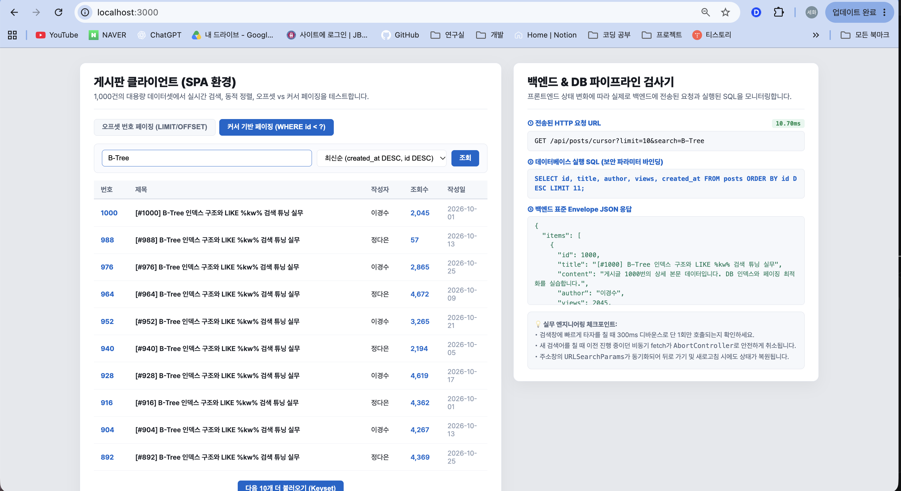

*그림 34. 검색 변경 후 누적 목록 초기화. 제출자가 직접 촬영한 원본 캡처.*

### 그림 35-1. 검색 조건 유지한 다음 커서 응답

검증 목적: 더 보기에도 search와 cursor 함께 적용.

| 기대 결과 | 실제 결과 | 판정 |
|---|---|---|
| search=B-Tree, cursor=892 → nextCursor=772 | 요청에 두 조건이 유지되며 JSON에 cursor=892, nextCursor=772, hasNext=true가 표시된다 | 성공 |

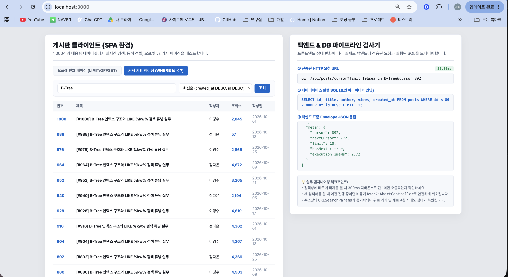

*그림 35-1. 검색 조건 유지한 다음 커서 응답. 제출자가 직접 촬영한 원본 캡처.*

### 그림 35-2. 커서 검색 20개 누적

검증 목적: 검색된 다음 목록 연결.

| 기대 결과 | 실제 결과 | 판정 |
|---|---|---|
| 기존 10개 뒤에 다음 10개, 끝 ID 772 | 사진의 하단 목록이 772까지 이어지고 기록상 20개가 누적된다. 상단은 그림 35-1과 함께 확인한다 | 20개 누적 범위 성공 |

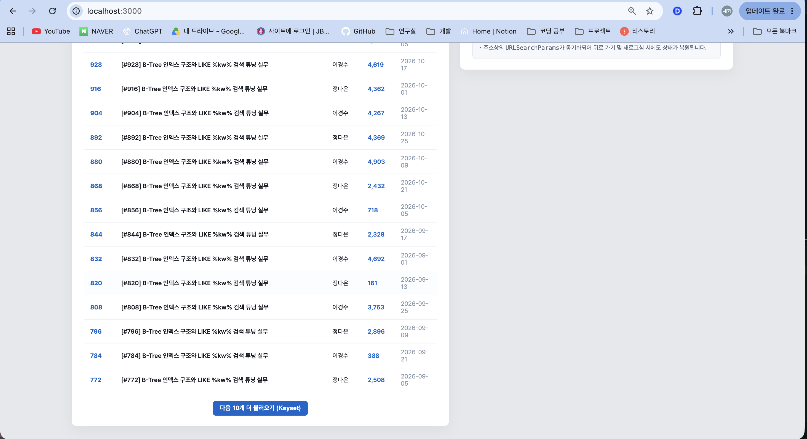

*그림 35-2. 커서 검색 20개 누적. 제출자가 직접 촬영한 원본 캡처.*

결과 분석: 없는 검색어는 빈 목록으로 처리되며, B-Tree 검색은 첫 페이지 nextCursor=892, 다음 페이지 772로 이어진다. 두 화면을 합쳐 확인한 UI 누적 범위는 20개다. 제목 검색 전체 순회 근거는 그림 38에서 별도로 제시한다. 커서 본문 검색은 현재 소스의 content 조건과 7장의 보조 실행으로 확인했으며 이에 해당하는 별도 사용자 촬영 사진은 없다.

### 5.4 커서 정렬 UI 정합성

원본 switchMode()는 탭·페이지 바·더 보기 표시만 전환하여 정렬 메뉴가 남았다. 개선 후에는 커서 모드의 정렬 메뉴를 비활성화·숨김 처리하고 실제 기준을 안내한다.

```javascript
const sortSelect = document.getElementById('sortSelect');
sortSelect.disabled = (mode === 'cursor');
sortSelect.style.display = (mode === 'cursor') ? 'none' : '';
document.getElementById('cursorSortNotice').style.display =
  (mode === 'cursor') ? 'inline-block' : 'none';
```

안내 요소의 문구는 “🔒 ID 내림차순 고정”이다. 오프셋으로 돌아오면 정렬 메뉴를 다시 사용할 수 있다.

### 그림 19. 개선 전 커서 최초 조회와 정렬 UI

검증 목적: 커서 기본 조회 및 UI 정합성 확인.

| 기대 결과 | 실제 결과 | 판정 |
|---|---|---|
| ID 1000~991, nextCursor=991, 실제 기준 안내 | 기본 10개와 hasNext=true는 정상이나 날짜 정렬 메뉴가 남아 실제 ID 정렬과 혼동된다. 주소창에도 오프셋 조건이 남는다 | 조회 성공 / 정렬 UI 개선 필요 → 그림 36-1 |

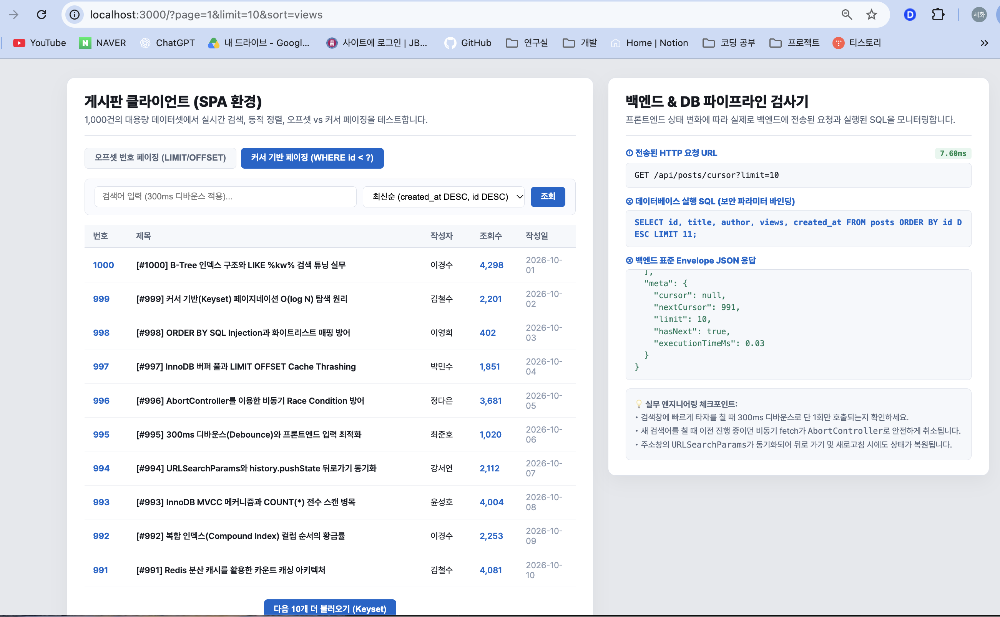

*그림 19. 개선 전 커서 최초 조회와 정렬 UI. 제출자가 직접 촬영한 원본 캡처.*

### 그림 36-1. 개선 후 커서 고정 정렬 안내

검증 목적: 실제 커서 기준과 UI 일치.

| 기대 결과 | 실제 결과 | 판정 |
|---|---|---|
| 정렬 메뉴 숨김, ID 내림차순 고정 안내 | 정렬 메뉴 대신 고정 안내가 표시되고 실제 목록은 ID 1000~991이다 | 성공 / 주소창의 커서 상태 저장은 별도 한계 |

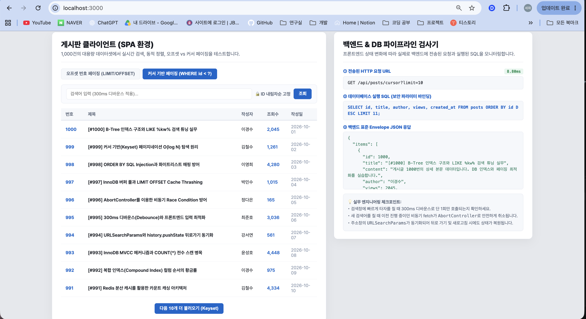

*그림 36-1. 개선 후 커서 고정 정렬 안내. 제출자가 직접 촬영한 원본 캡처.*

### 그림 36-2. 오프셋 복귀 후 메뉴 복원

검증 목적: 모드 전환 UI 복원.

| 기대 결과 | 실제 결과 | 판정 |
|---|---|---|
| 정렬 메뉴 복원, 고정 안내 숨김 | 최신순 메뉴가 복원되고 날짜순 목록 및 오프셋 요청이 표시된다 | 성공 |

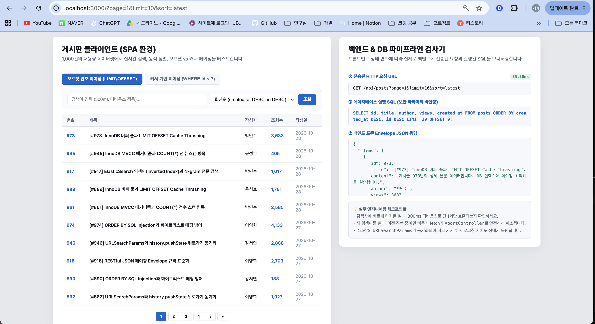

*그림 36-2. 오프셋 복귀 후 메뉴 복원. 제출자가 직접 촬영한 원본 캡처.*

결과 분석: 커서 API의 고정 정렬 기준과 화면의 안내를 일치시켰다. 커서 모드의 주소창 저장·복원까지 개선한 것은 아니며 오프셋 쿼리가 남는 한계는 유지된다.

## 6. 비동기 처리와 URL 상태 재검증

### 6.1 디바운스: 코드 변경 없이 검증 조건 보완

원본 input 이벤트는 clearTimeout() 후 300ms 타이머를 다시 설정한다. 각 입력 사이에 300ms 이상 멈추면 중간 요청이 발생할 수 있다. 따라서 수동 입력에서 5건을 보았다는 사실만으로 실패라고 판정하지 않았다. 이후 대기 없이 6회 연속 이벤트를 발생시키는 방식으로 조건을 통제했다.

### 그림 24. 수동 입력 디바운스 관찰

검증 목적: 300ms 입력 조건과 요청 수 확인.

| 기대 결과 | 실제 결과 | 판정 |
|---|---|---|
| 모든 입력 간격이 300ms 미만이면 1회 | Network에 5건이 나타났지만 입력 간격을 통제하지 않아 원인을 확정할 수 없다 | 판정 보류 → 그림 37에서 조건 통제 재검증 |

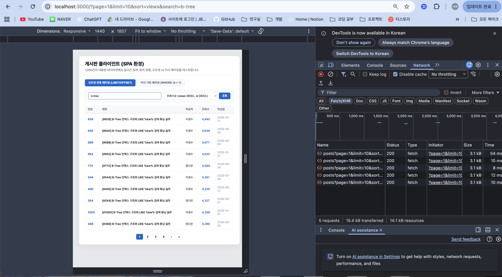

*그림 24. 수동 입력 디바운스 관찰. 제출자가 직접 촬영한 원본 캡처.*

### 그림 37. 디바운스 조건 통제 재검증

검증 목적: 6회 연속 입력 이벤트의 요청 수 확인.

| 기대 결과 | 실제 결과 | 판정 |
|---|---|---|
| 별도 대기 없이 6회 입력 후 API 1회·200 | 기록에서 B→B-→B-T→B-Tr→B-Tre→B-Tree 이벤트를 연속 발생시켰으며 Network에서 search=B-Tree 1건·200을 확인했다. 사진은 요청 수의 근거로 사용한다 | 성공 / 코드 수정이 아닌 검증 방법 보완 |

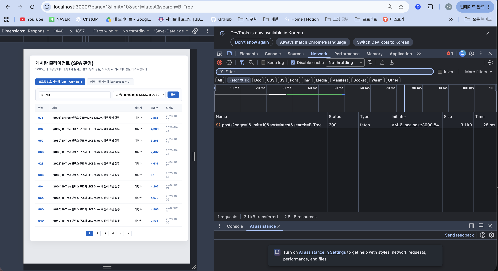

*그림 37. 디바운스 조건 통제 재검증. 제출자가 직접 촬영한 원본 캡처.*

결과 분석: 연속 입력 6회가 검색 요청 1회로 모였다. 기존 디바운스의 동작을 재검증한 것이며 디바운스 개선 커밋이나 수정 전후 성능 향상으로 기술하지 않는다. 이 사진은 요청 수 검증이며 날짜 정렬 등의 독립 증거로 사용하지 않는다.

### 6.2 AbortController와 최신 검색 결과

loadData()는 새로운 요청을 시작할 때 기존 컨트롤러의 abort()를 호출하고 새 signal을 fetch에 전달한다. catch에서 AbortError를 일반 오류와 구분해 취소 안내를 남긴다. 검색 입력 직후가 아니라 다음 loadData()가 시작되는 시점에 이전 요청을 취소한다.

### 그림 25-1. 3G 이전 요청 취소

검증 목적: 느린 응답에서 최신 검색 결과 유지.

| 기대 결과 | 실제 결과 | 판정 |
|---|---|---|
| 이전 요청 canceled, 최종 redis HTTP 200 | search=b-tree 및 중간 요청 취소, 최종 search=redis의 200 응답과 Redis 목록을 확인했다 | 관찰한 시나리오 성공 |

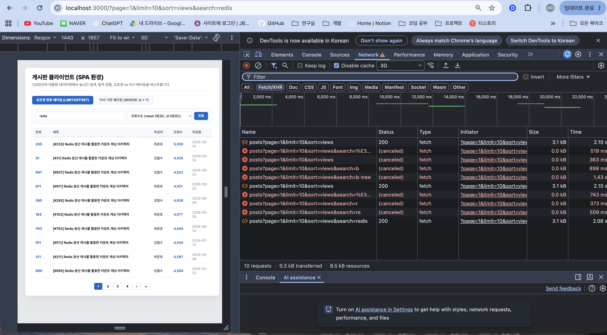

*그림 25-1. 3G 이전 요청 취소. 제출자가 직접 촬영한 원본 캡처.*

### 그림 25-2. AbortError 안전 처리

검증 목적: 취소 예외가 일반 오류로 남는지 확인.

| 기대 결과 | 실제 결과 | 판정 |
|---|---|---|
| 취소 안내 로그, 화면 유지 | 이전 비동기 요청이 정상 취소되었다는 로그가 7회 묶여 표시되며 Redis 결과가 유지된다 | 관찰한 시나리오 성공 |

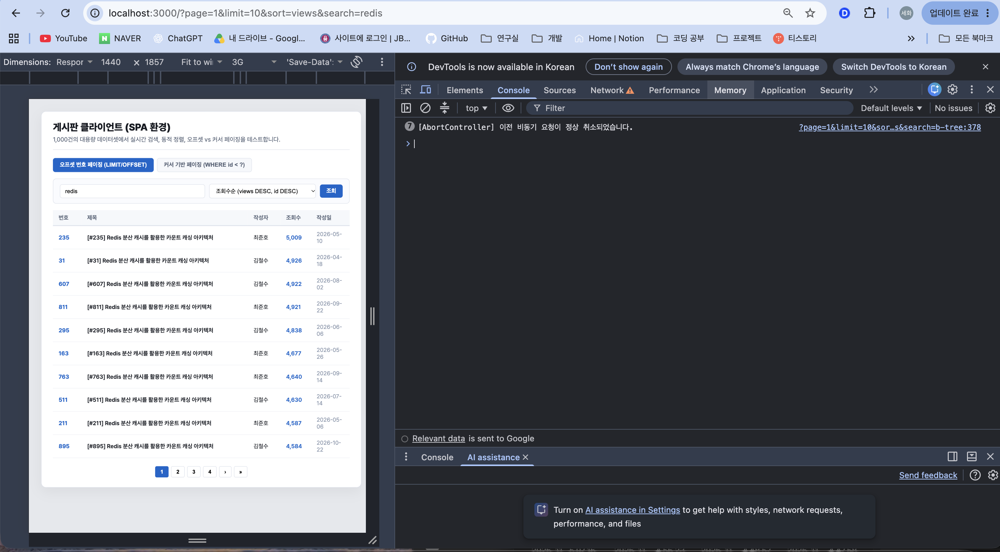

*그림 25-2. AbortError 안전 처리. 제출자가 직접 촬영한 원본 캡처.*

결과 분석: 3G 환경에서 이전 요청이 취소되고 최신 Redis 결과가 유지되는 시나리오를 관찰했다. 모든 응답 경쟁 상황에 대한 형식적 보장을 주장하지 않는다.

### 6.3 오프셋 URL 상태 복원

오프셋 요청에서 page·limit·sort·search를 URLSearchParams로 구성하고 history.pushState()에 반영한다. 초기 로드와 popstate는 URL의 page·sort·search를 읽어 컨트롤과 요청을 복원한다. limit는 URL에 기록되지만 읽어 복원하지 않으며, 테스트의 10개는 기본 state.limit이다. 커서 모드와 누적 위치는 URL 복원 범위에 포함하지 않는다.

### 그림 26. 새로고침 상태 복원

검증 목적: 오프셋 URL의 검색·정렬·페이지 복원.

| 기대 결과 | 실제 결과 | 판정 |
|---|---|---|
| redis·views·page=2의 URL·컨트롤·결과 일치 | 새로고침 후 검색창 redis, 조회수순, 2페이지 및 해당 목록이 유지된다 | 성공 / 오프셋 범위 |

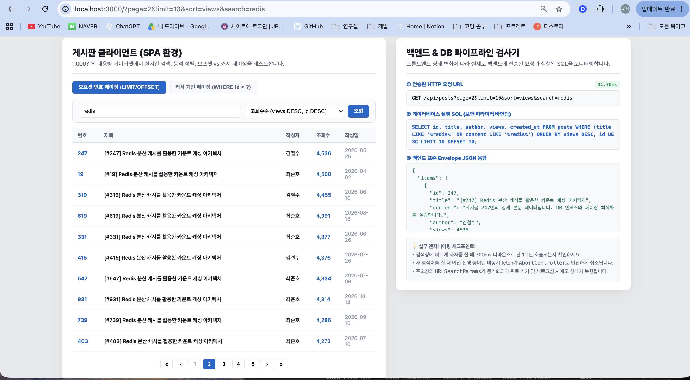

*그림 26. 새로고침 상태 복원. 제출자가 직접 촬영한 원본 캡처.*

### 그림 27. 뒤로 가기 상태 복원

검증 목적: popstate로 이전 검색 상태 재구성.

| 기대 결과 | 실제 결과 | 판정 |
|---|---|---|
| B-Tree 검색 후 뒤로 가면 redis·views·2페이지 복원 | 주소·검색창·정렬·선택 페이지·요청과 목록이 이전 상태로 복원된다 | 성공 / 오프셋 범위 |


*그림 27. 뒤로 가기 상태 복원. 제출자가 직접 촬영한 원본 캡처.*

## 7. 수정 후 전체 결과와 보조 검증

| 개선·재검증 항목 | 기대 | 확인 결과 | 근거·판정 |
|---|---|---|---|
| __proto__·constructor | 상속 속성 거부·latest 대체 | 정상 JSON, 현재 소스 직접 키 검사 | 28·29·소스·보조 실행, 성공 |
| 날짜 최신순·오래된순 | 날짜 및 동점 ID 정렬 | 각 날짜·ID 방향 일치 | 30·31, 성공 |
| 커서 제목·빈 검색 | 조건 적용·빈 결과 종료 | B-Tree·빈 목록 메타 확인 | 32~35, 성공 |
| 커서 정렬 UI | 고정 안내·오프셋 메뉴 복원 | 메뉴·안내 전환 정상 | 36 두 장, 성공 |
| 디바운스 6회 연속 입력 | API 1회 | 1건·HTTP 200 | 37, 성공 |
| 전체 커서 제목 검색 | 84건·9회·중복 0 | 첫 ID 1000, 마지막 4, 종료 false | 38, 백엔드 범위 성공 |
| 커서 본문 전체 검색 | 1,000건·100회·중복 0 | 첫 ID 1000, 마지막 1, 종료 false | 현재 처리 함수 보조 실행, 별도 사진 없음 |

### 그림 38. 전체 커서 검색 누락·중복 검증

검증 목적: B-Tree API를 종료까지 순차 조회.

| 기대 결과 | 실제 결과 | 판정 |
|---|---|---|
| 84건·9회·중복 0, 첫 ID 1000, 마지막 4, hasNext=false | Console에 요청 9, 전체 84, 중복 0, 첫 ID 1000, 마지막 4, 최종 false와 성공이 표시된다. ID 간격 12 및 정확한 기대 ID 집합은 보조 실행에서도 일치했다 | 백엔드 전체 제목 검색 성공 / 전체 UI 누적은 별도 검증 대상 |

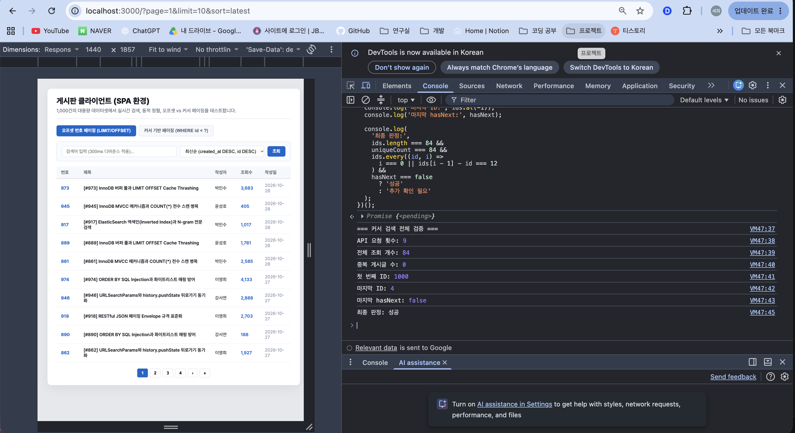

*그림 38. 전체 커서 검색 누락·중복 검증. 제출자가 직접 촬영한 원본 캡처.*

### 7.1 현재 처리 함수 보조 검증 방법

2026년 11월 14일 문서 작성 환경에서 server.js를 변경하지 않고 Node.js vm으로 읽었다. Express의 라우트 등록·listen을 캡처하는 대체 객체를 주입한 뒤 실제 등록된 두 API 콜백에 req.query와 응답 수집 객체를 전달했다. 이 방식은 서버 처리 로직 실행이며 Express의 실제 HTTP 파싱·전송이나 브라우저 동작을 검증하지 않는다. 테스트 도구는 임시 경로에서 실행했으며 기능 소스에는 추가하지 않았다.

검증 묶음 21개가 통과했다. 기본 데이터와 페이지 수, page=0·-1·abc, limit=1000, 오프셋 제목·본문·빈 검색, invalid·__proto__·constructor의 최종 latest 대체, 세 정렬의 전체 1,000건 순서, 2·마지막 페이지 경계, 커서 기본·마지막·검색·빈 결과, 제목·본문 전체 순회를 확인했다.

| 전체 커서 조건 | 반환 수 | 처리 함수 호출 수 | 중복 | 첫 ID | 마지막 ID | 마지막 hasNext |
|---|---|---|---|---|---|---|
| B-Tree | 84 | 9 | 0 | 1000 | 4 | false |
| 상세 본문 | 1,000 | 100 | 0 | 1000 | 1 | false |

B-Tree의 기대 ID는 1000−12×k (k=0~83)로 생성 규칙에서 계산하고, 수집한 전체 배열과 정확하게 비교했다. 개수·중복 검사뿐 아니라 누락·순서도 대조했다. 본문 검색도 1000~1의 전체 기대 배열과 비교했다. 조회수 값 자체는 무작위이므로 특정 숫자를 재현하지 않고 정렬 관계를 확인했다.

### 7.2 검증 범위의 제한

그림 22는 DevTools로 마지막 커서를 설정한 상황이며 전체 1,000건 UI 순회가 아니다. 비활성 버튼 클릭 후 추가 요청이 실제 0건인지도 별도 촬영되지 않았다. 그림 38은 Console API 순회이며 화면에 84건을 모두 누적 표시한 검증이 아니다. UI 누적은 그림 20·35의 20개 범위까지 확인했다. 보조 실행은 이를 새 브라우저 검증으로 대체하지 않는다.

## 8. 필수 개념 설명

### 8.1 오프셋과 커서에 적합한 화면

오프셋은 전체 개수·페이지 수와 번호 버튼을 제공하여 특정 페이지로 바로 이동하는 게시판에 적합하다. 커서는 마지막 ID를 다음 시작 조건으로 사용하므로 피드나 더 보기 같은 순차 탐색에 적합하다. 현재 화면은 자동 무한 스크롤이 아닌 더 보기 버튼 방식이다.

현재 커서는 ID 내림차순과 id < cursor가 한 쌍이다. 날짜·조회수순으로 바꾸려면 그 정렬 기준과 동점 처리를 담는 커서 설계가 필요하다. 현재 API에 그 기능이 있다고 가정하지 않는다.

### 8.2 디바운스와 요청 취소의 역할

디바운스는 요청을 시작하기 전에 입력을 모아 호출 수를 줄인다. 이 구현은 마지막 input 이후 300ms 동안 추가 입력이 없으면 검색한다. AbortController는 이미 진행 중인 이전 요청을 다음 loadData() 시작 시 취소해 오래된 응답이 최신 상태를 덮어쓸 위험을 줄인다. 취소로 발생하는 AbortError를 안전하게 처리해야 한다. 두 기능은 각각 호출 빈도와 진행 중인 요청을 다룬다.

### 8.3 limit+1의 원리

검색과 커서 조건에 맞는 후보에서 요청 개수보다 하나 더 확인한다. limit=10이면 11개를 살펴보고 11번째가 있으면 10개만 반환하며 hasNext=true로 표시한다. 마지막에 4개만 남으면 4개와 hasNext=false를 반환한다. 전체 개수를 응답하기 위한 별도 집계 없이 다음 묶음의 유무를 결정할 수 있다.

현재 코드는 배열 filter로 후보를 순회한 뒤 slice(0, limit+1)를 수행한다. 실제 인덱스 탐색으로 다음 11건만 읽는 데이터베이스 구현이 아니므로 O(log N)이나 오프셋보다 빠르다는 실증으로 해석하지 않는다.

### 8.4 offset과 totalPages 계산

```text
totalPages = max(1, ceil(totalCount / limit))
safePage   = min(보정한 page, totalPages)
offset     = (safePage - 1) × limit
hasNext    = safePage < totalPages
hasPrev    = safePage > 1
```

10개씩 2페이지는 offset=(2−1)×10=10, 100페이지는 990이다. 1,000건은 100페이지, B-Tree 84건은 ceil(84/10)=9페이지다. 0건은 수학적 올림값 0 대신 구현상 최소 1페이지를 유지한다. page=0·-1·abc는 1, 마지막 페이지를 넘는 양수는 마지막 페이지로 보정한다. offset은 메타 필드가 아니라 계산값이다.

## 9. 문제 해결·디버깅 기록

| 문제·증상 | 원인 | 시도 | 해결 | 검증 | 교훈 |
|---|---|---|---|---|---|
| __proto__에서 TypeError | 상속 객체를 sort 비교 함수로 선택 | 원본 정렬 키 접근·오류 사진 대조 | typeof와 Object.hasOwn 검사 | 9↔28, 최종 대체 검증 | 응답 성공 외에 선택 경로를 검증해야 함 |
| constructor 정상처럼 보임 | 상속 함수·원본 배열 순서 때문에 문제 은폐 | 사진과 원본 소스를 교차 확인 | 직접 키만 허용 | 10↔29 및 소스 | 정상 JSON만으로 보안을 판정하지 않음 |
| 커서에서 없는 검색어도 목록 출력 | 프론트 search 누락·백엔드 필터 없음 | 요청 URL·JSON·두 계층 대조 | 양쪽 검색 연결, 필터 뒤 limit+1 | 23↔33, 32~35·38 | 입력창 상태와 서버 조건을 함께 확인 |
| 날짜 정렬 표시 불일치 | ID와 날짜가 같은 순서라는 가정 | 목록의 날짜·ID 비교 | 날짜 우선·ID 2차 정렬 | 5↔30, 6↔31 | 화면 설명과 비교 함수를 일치시킴 |
| 디바운스 요청 5건 | 입력 간격 미통제 | 대기 없는 6회 이벤트 재검증 | 테스트 방법 보완, 코드 유지 | 24→37 | 불확실한 관찰을 곧바로 실패로 단정하지 않음 |
| 보고서 근거 불일치 | 기록과 파일·촬영 상태 차이 | 실파일·이미지 전수 대조 | 실제 경로·촬영 시점 표기 | 그림 1·28 및 부록 B | 기록을 보존하고 해석의 차이를 명시 |

## 10. AI 활용 및 본인 검증

AI는 원본·개선 코드 분석, 문제 원인과 개선 방향 정리, 코드 및 개념 설명, README·보고서 작성, 캡처·기록 대조와 처리 함수 보조 검증에 활용하였다. 코드 개선 시 AI 도움을 활용했으며 독자적으로 모든 코드를 작성했다고 주장하지 않는다.

제출자는 브라우저와 DevTools에서 검색·정렬·파라미터·페이지 이동·요청 취소·URL 복원을 직접 실행하고 캡처를 촬영·기록하였다. 통제된 입력 이벤트와 전체 커서 조회도 Console에서 실행해 그림 37·38로 남겼다. 수정 내용은 기존 Git 커밋 이력으로 확인하였다.

이번 문서화에서는 기능 코드·원본 기록·원본 이미지를 변경하지 않았다. 새 캡처 생성·이미지 변조·커밋·푸시는 수행하지 않았다. 문서 작성 도중 추가 실행한 21개 보조 검증을 제출자가 새로 촬영한 검증으로 기재하지 않았다.

## 11. 결론 및 한계

상속 속성을 허용하던 정렬 키 선택, 작성일과 불일치하던 최신순·오래된순, 커서 검색 누락, 커서 정렬 메뉴의 혼동을 개선하였다. 원본 기능인 오프셋 경계 보정·조회수 동점 처리·요청 취소·오프셋 URL 복원은 기존 기록과 코드에서 확인했다. 디바운스는 검증 조건을 통제해 요청 1회를 재확인하였다.

제목 B-Tree의 전체 커서 API 조회는 84건·9회·중복 0건·마지막 hasNext=false다. 현재 처리 함수로 본문 검색 전체 조회까지 확인했으나 본문 커서 검색의 사용자 촬영 캡처, 84건 전체 UI 누적, 비활성 버튼 클릭 시 요청 수 확인은 추가 검증 대상이다.

인메모리 배열과 무작위 조회수를 사용하는 실습이므로 실제 DB 인덱스 성능·O(log N)·커서 속도 우위를 입증하지 않는다. executionTimeMs와 X-Response-Time은 서버 처리 구간이며 화면 배지는 fetch와 JSON 처리까지의 클라이언트 시간으로 측정 범위가 다르다.

추가 개선점은 커서 모드·누적 위치의 URL 저장·복원, URL limit 복원, SQL 패널의 실제 실행·바인딩 오해 문구 수정 및 커서 검색 조건 미리보기 반영이다. 실제 함수는 오프셋 search를 단일 문자열로 가정하므로 반복 파라미터 등 비정상 자료형에 대한 방어 범위도 별도 검증할 수 있다. 이번 범위에서는 기능 코드를 수정하지 않았다.

## 부록 A. 나머지 원본 검증 캡처

본문에는 수정 전후 비교와 주요 재검증을 배치하고, 아래에는 기존 기능·경계 조건의 원본 캡처를 수록하였다. 본문과 부록을 합쳐 그림 1~38, 두 장짜리 20·25·35·36을 포함한 총 42개 원본 파일을 모두 삽입하였다. 각 사진은 한 번씩 삽입했다.

### A.1 실행·검색·조회수·기본 정렬 키

### 그림 1. 기존 게시판 실행 화면

검증 목적: 화면·목록·요청 패널의 구동 확인.

| 기대 결과 | 실제 결과 | 판정 |
|---|---|---|
| 최초 접속은 기본 latest·1페이지·10개 | 실제 사진은 page=30, ID 710~701의 10개와 요청 패널을 표시한다. 기록의 최초 1페이지 설명과 다르다 | 구동 확인 / 최초 1페이지 근거로 사용하지 않음 |

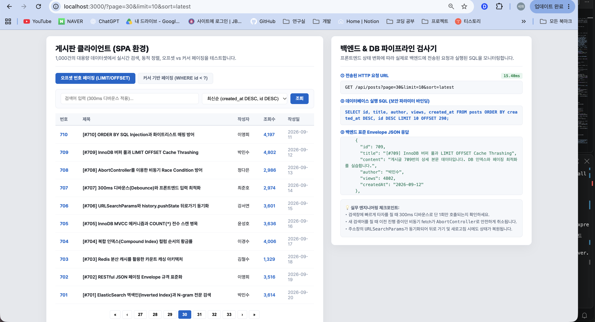

*그림 1. 기존 게시판 실행 화면. 제출자가 직접 촬영한 원본 캡처.*

### 그림 2. 제목 검색

검증 목적: 제목 B-Tree 검색 검증.

| 기대 결과 | 실제 결과 | 판정 |
|---|---|---|
| 제목에 B-Tree를 포함한 목록만 반환 | B-Tree 포함 게시글 10개가 표시되고 search=B-Tree 요청을 확인했다. 전체 84건·9페이지는 그림 17과 현재 처리 함수 검증으로 보완한다 | 성공 |

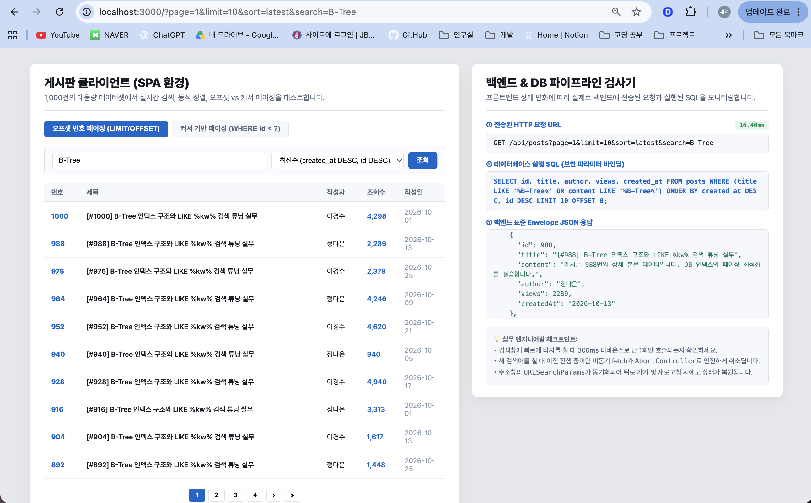

*그림 2. 제목 검색. 제출자가 직접 촬영한 원본 캡처.*

### 그림 3. 오프셋 검색 결과 없음

검증 목적: 없는 검색어의 빈 결과 처리.

| 기대 결과 | 실제 결과 | 판정 |
|---|---|---|
| items=[], totalCount=0, totalPages=1, 양방향 이동 불가 | B-존재하지않는게시글99999 검색에서 빈 목록 안내와 hasNext=false·hasPrev=false가 표시된다 | 성공 |

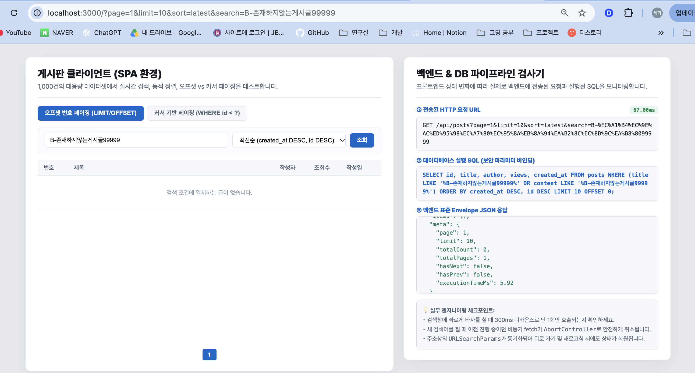

*그림 3. 오프셋 검색 결과 없음. 제출자가 직접 촬영한 원본 캡처.*

### 그림 4. 본문 검색

검증 목적: 제목이 아닌 본문 조건 적용.

| 기대 결과 | 실제 결과 | 판정 |
|---|---|---|
| 상세 본문 검색 결과 1,000건·100페이지 | 제목에 검색어가 없어도 content에 상세 본문이 포함된 게시글을 반환한다. 전체 수·페이지 수는 기록과 처리 함수 검증에서 확인했다 | 성공 |

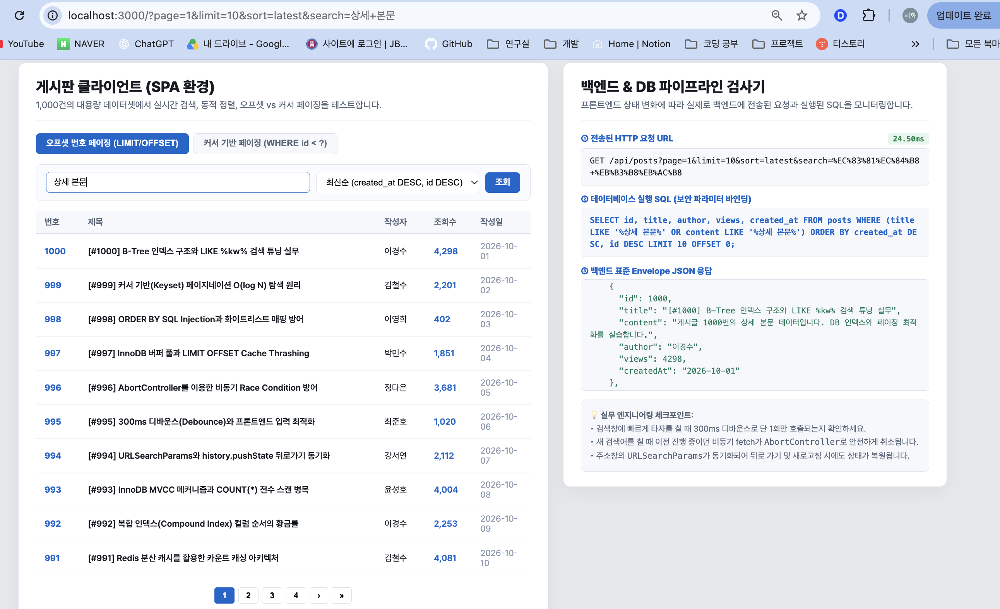

*그림 4. 본문 검색. 제출자가 직접 촬영한 원본 캡처.*

### 그림 7. 조회수 및 동점 정렬

검증 목적: views DESC와 동점 id DESC 검증.

| 기대 결과 | 실제 결과 | 판정 |
|---|---|---|
| 조회수가 같으면 더 큰 ID 우선 | 당시 조회수 5,009는 ID 893→235→219, 4,979는 561→262 순서다. 실행마다 조회수는 달라질 수 있다 | 성공 |

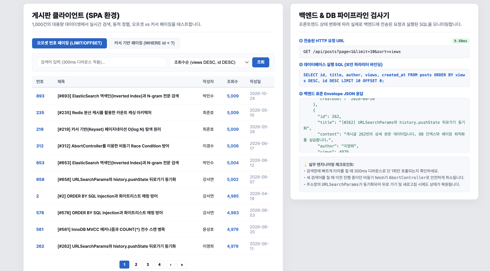

*그림 7. 조회수 및 동점 정렬. 제출자가 직접 촬영한 원본 캡처.*

### 그림 8. 잘못된 정렬 키

검증 목적: invalid 기본값 처리.

| 기대 결과 | 실제 결과 | 판정 |
|---|---|---|
| 허용하지 않은 키를 latest로 대체 | 원본 시점 정상 JSON과 ID 1000부터의 순서를 확인했다. 최종 latest는 ID만이 아닌 날짜 우선 정렬이다 | 원본 기본값 처리 성공 / 최종 기준은 보조 검증 |

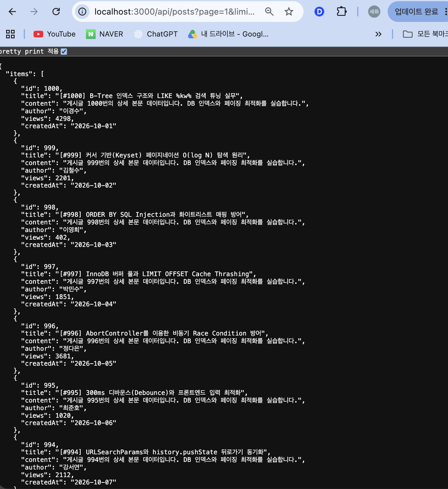

*그림 8. 잘못된 정렬 키. 제출자가 직접 촬영한 원본 캡처.*

### A.2 오프셋 경계와 상태 초기화

### 그림 11. page=0 보정

검증 목적: 0 페이지 경계값 처리.

| 기대 결과 | 실제 결과 | 판정 |
|---|---|---|
| meta.page=1 및 기본 10개 | meta.page=1, limit=10, totalCount=1000, totalPages=100을 확인했다 | 성공 |

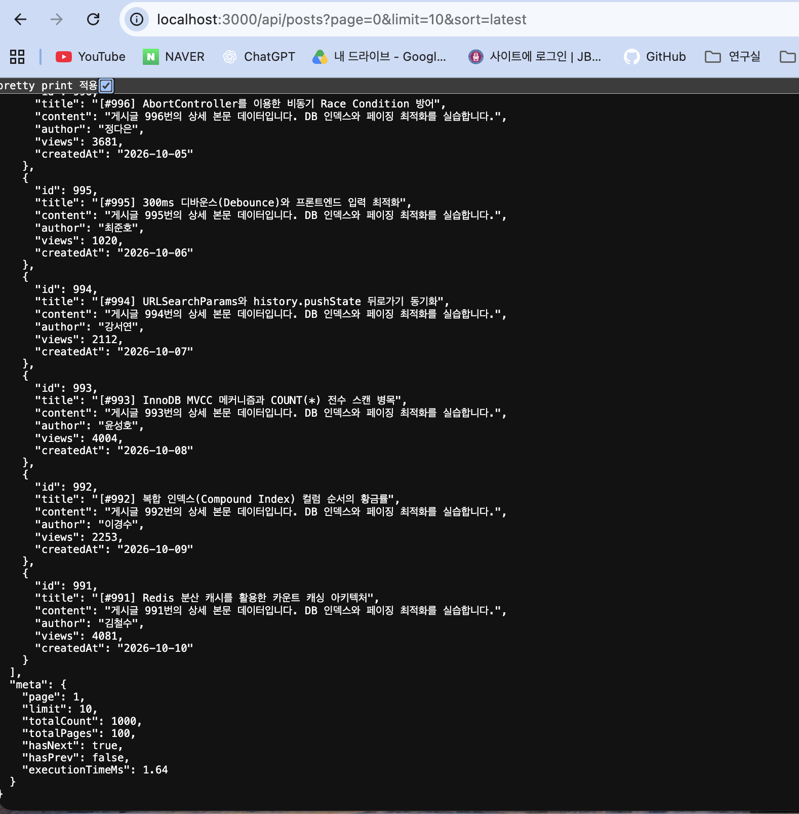

*그림 11. page=0 보정. 제출자가 직접 촬영한 원본 캡처.*

### 그림 12. page=-1 보정

검증 목적: 음수 페이지 경계값 처리.

| 기대 결과 | 실제 결과 | 판정 |
|---|---|---|
| meta.page=1 및 정상 응답 | meta.page=1과 10개 반환을 확인했다 | 성공 |

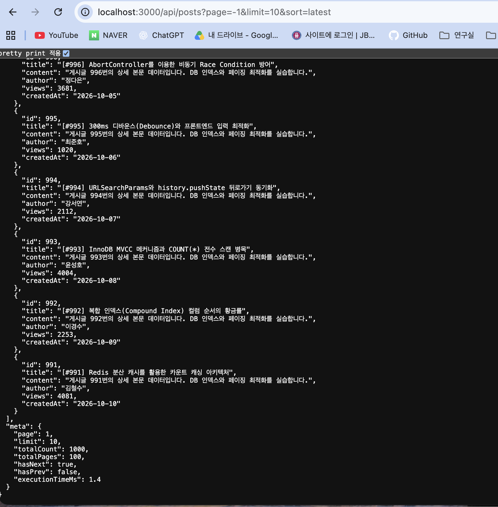

*그림 12. page=-1 보정. 제출자가 직접 촬영한 원본 캡처.*

### 그림 13. page=abc 보정

검증 목적: 숫자가 아닌 페이지 처리.

| 기대 결과 | 실제 결과 | 판정 |
|---|---|---|
| meta.page=1 및 정상 응답 | 문자 입력을 1페이지로 보정하고 전체 1,000건·100페이지를 반환했다 | 성공 |

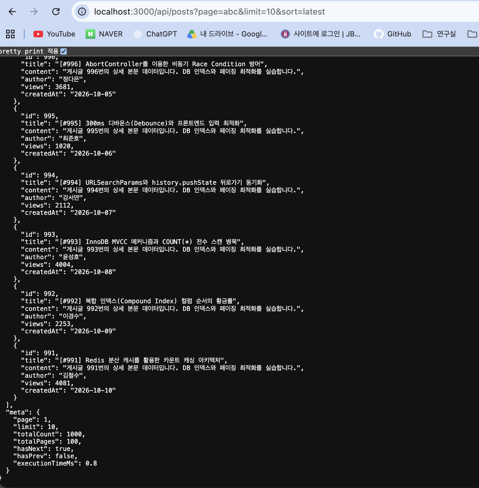

*그림 13. page=abc 보정. 제출자가 직접 촬영한 원본 캡처.*

### 그림 14. 최대 조회 개수 제한

검증 목적: limit 상한 검증.

| 기대 결과 | 실제 결과 | 판정 |
|---|---|---|
| 100개로 제한, 전체 페이지 10 | meta.limit=100, totalPages=10을 확인했다. 사진의 ID 목록은 원본 ID 정렬 시점이다 | 성공 |

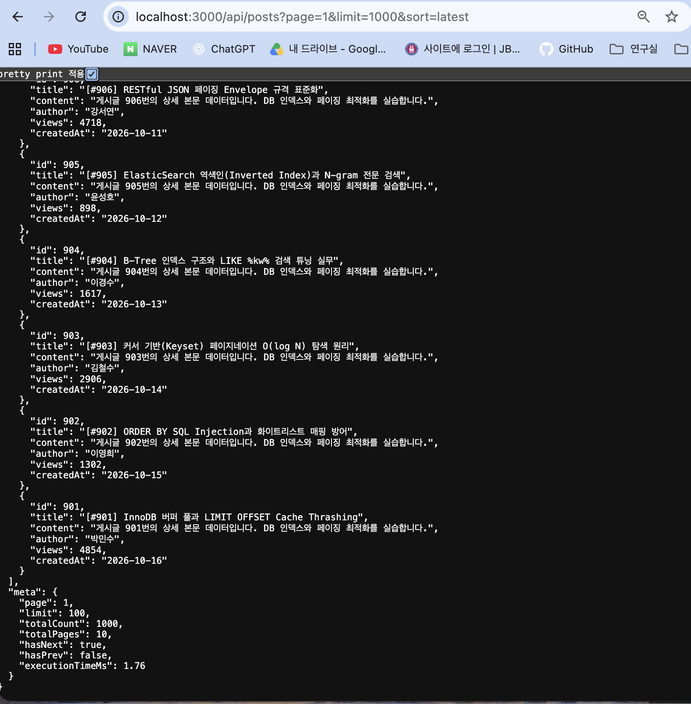

*그림 14. 최대 조회 개수 제한. 제출자가 직접 촬영한 원본 캡처.*

### 그림 15. 오프셋 2페이지

검증 목적: 페이지 이동과 offset 계산 검증.

| 기대 결과 | 실제 결과 | 판정 |
|---|---|---|
| page=2, offset=10, 이전·다음 있음 | 원본 ID 정렬에서 990~981을 표시하고 meta.page=2, hasPrev=true, hasNext=true를 확인했다 | 성공 / 원본 정렬 시점 |

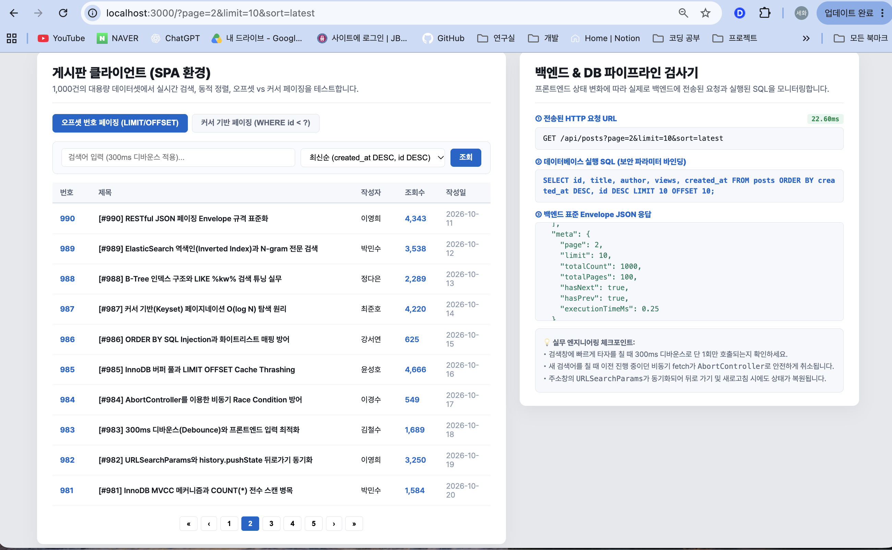

*그림 15. 오프셋 2페이지. 제출자가 직접 촬영한 원본 캡처.*

### 그림 16. 오프셋 마지막 페이지

검증 목적: 100페이지 경계 검증.

| 기대 결과 | 실제 결과 | 판정 |
|---|---|---|
| offset=990, hasNext=false, hasPrev=true | 원본 ID 정렬에서 ID 10~1을 표시하고 마지막 페이지 메타를 확인했다 | 성공 / 원본 정렬 시점 |

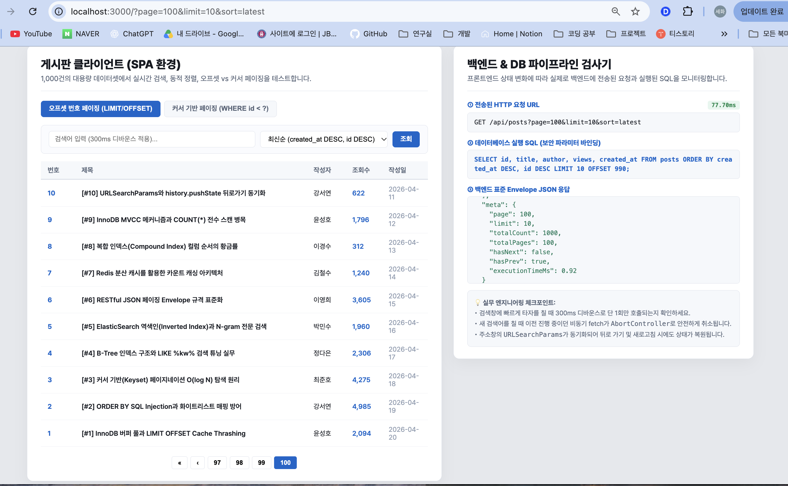

*그림 16. 오프셋 마지막 페이지. 제출자가 직접 촬영한 원본 캡처.*

### 그림 17. 검색 변경 시 페이지 초기화

검증 목적: 100페이지에서 검색 조건 변경.

| 기대 결과 | 실제 결과 | 판정 |
|---|---|---|
| page=1로 초기화하고 검색 결과 재계산 | B-Tree 검색 후 page=1, totalCount=84, totalPages=9를 확인했다 | 성공 |

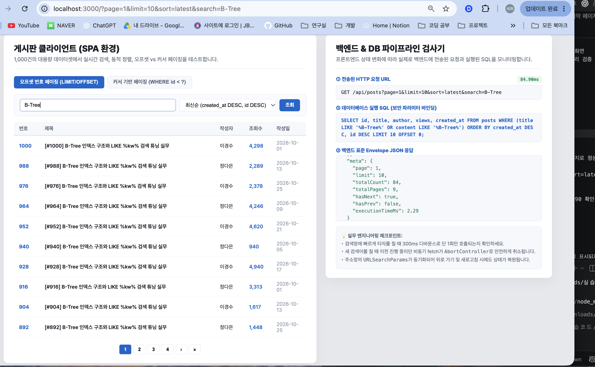

*그림 17. 검색 변경 시 페이지 초기화. 제출자가 직접 촬영한 원본 캡처.*

### 그림 18. 정렬 변경 시 페이지 초기화

검증 목적: 검색 결과 2페이지에서 정렬 변경.

| 기대 결과 | 실제 결과 | 판정 |
|---|---|---|
| B-Tree 유지, page=1, sort=views | 요청과 URL에 같은 검색어·views·1페이지가 반영되고 조회수순 결과가 표시된다 | 성공 |

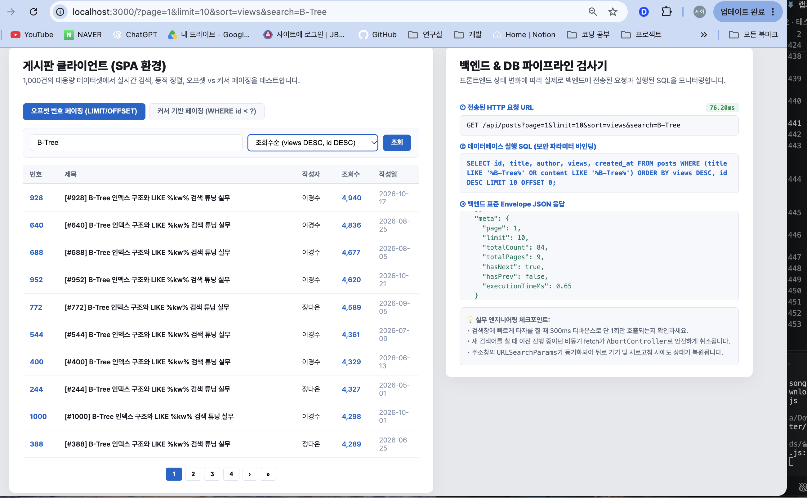

*그림 18. 정렬 변경 시 페이지 초기화. 제출자가 직접 촬영한 원본 캡처.*

### A.3 기본 커서 더 보기와 마지막 경계

### 그림 20-1. 커서 더 보기 API

검증 목적: 직전 마지막 ID를 다음 조건으로 전달.

| 기대 결과 | 실제 결과 | 판정 |
|---|---|---|
| cursor=991, 다음 10개·nextCursor=981 | 요청 cursor=991, 응답 nextCursor=981, hasNext=true를 확인했다 | 성공 |

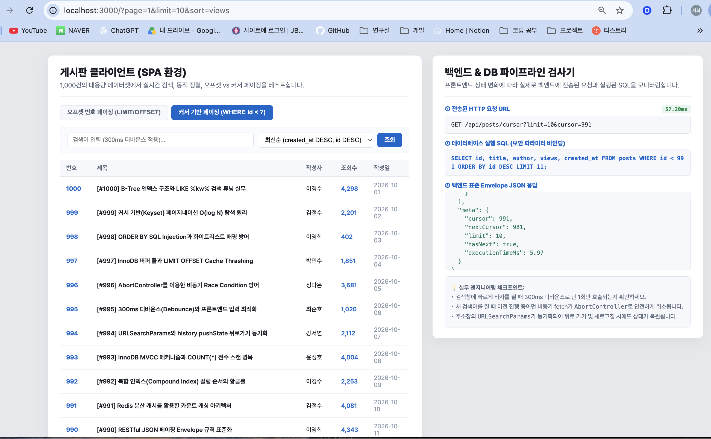

*그림 20-1. 커서 더 보기 API. 제출자가 직접 촬영한 원본 캡처.*

### 그림 20-2. 커서 더 보기 누적 목록

검증 목적: 새 데이터와 기존 목록 연결.

| 기대 결과 | 실제 결과 | 판정 |
|---|---|---|
| 기존 1000~991 뒤에 990~981 추가 | 하단에 ID 981까지 이어지며 기록에서 총 20개를 확인했다. 이 사진은 하단 구간이며 상단은 그림 20-1과 함께 확인한다 | 20개 누적 범위 성공 |

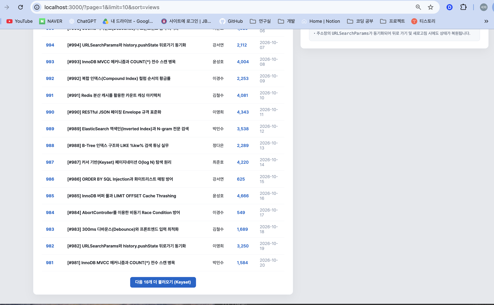

*그림 20-2. 커서 더 보기 누적 목록. 제출자가 직접 촬영한 원본 캡처.*

### 그림 21. 커서 마지막 API 응답

검증 목적: 남은 10개와 종료 메타 검증.

| 기대 결과 | 실제 결과 | 판정 |
|---|---|---|
| cursor=11 → ID 10~1, nextCursor=1, hasNext=false | 마지막 ID 1과 nextCursor=1, hasNext=false를 확인했다 | 성공 |

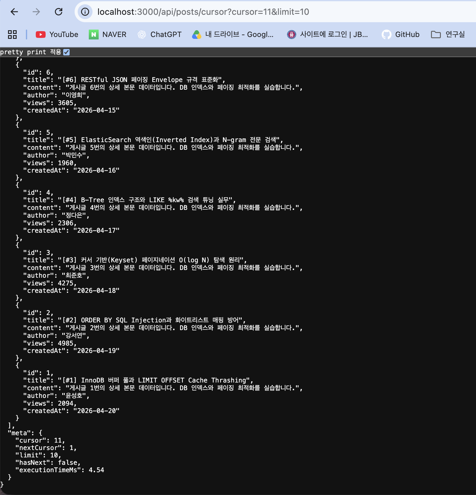

*그림 21. 커서 마지막 API 응답. 제출자가 직접 촬영한 원본 캡처.*

### 그림 22. 마지막 커서 상황의 버튼

검증 목적: hasNext=false의 UI 반영.

| 기대 결과 | 실제 결과 | 판정 |
|---|---|---|
| 더 보기 비활성화 및 종료 문구 | Console에서 state.cursor=11, cursorPosts=[], loadData(false)로 마지막 상황을 재현하고 종료 문구를 확인했다. disabled 적용은 소스와 대조했다 | 해당 상황 성공 / 1,000건 전체 UI 순회·비활성 버튼 클릭 요청은 미검증 |

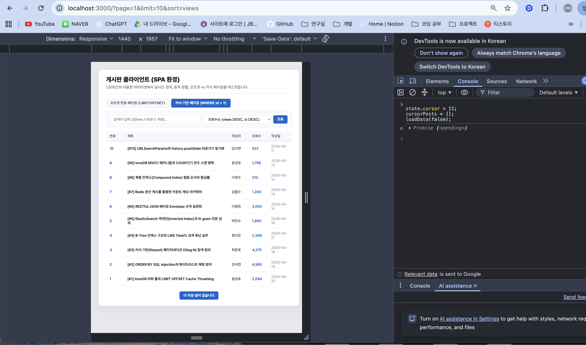

*그림 22. 마지막 커서 상황의 버튼. 제출자가 직접 촬영한 원본 캡처.*

## 부록 B. 근거 파일·Git 상태·문서 점검 기록

| 점검 | 실제 확인 및 처리 |
|---|---|
| 기록 파일명 | 인수인계서의 캡처기록.md와 달리 실제 파일은 캡쳐기록.md. 링크는 실제 이름 사용, 내용 보존 |
| 그림 28 파일명 | fig28_sort_proto_fixed..png에 점이 두 개. 원본명 그대로 링크 |
| 그림 1 | 기록은 최초 1페이지라 설명하나 사진은 30페이지. 사진 기준으로 정정하여 해석 |
| 보안 개선 시점 | 28·29는 날짜 정렬 개선 전이므로 ID 순서. 최종 latest 기준과 구분 |
| 그림 36 기록 | 앞부분의 복귀 추가 확인 필요 문구 뒤에 36-2 추가 검증 완료 기록 존재. 최종 기록과 사진 대조 |
| 이미지 | 실제 PNG 42개 존재, 누락 없음. 본문·부록의 42개 상대 경로를 검증 |
| 제출자 정보 | 사용자 제공 컴퓨터인공지능학부·202346113·송세화 반영 |
| Git 시작 상태 | main, 캡쳐기록.md는 기존 수정 상태, 그림 37·38은 기존 미추적 상태. 그대로 보존 |
| remote | origin: https://github.com/sehwa-song/week09-board-improvement.git |
| 공개 범위 | 원격 저장소의 공개 설정·최신 원격 반영 여부는 확인하지 않음 |
| 노출 정보 | 그림 9에 로컬 사용자 경로가 있고 해당 사진은 Git 추적 대상. 여러 사진에는 북마크·브라우저 프로필 등 화면 정보 포함 |

그림 9 등 원본 사진은 가림 처리나 수정 없이 보존하였다. 원격 공개 여부는 로컬 remote 주소만으로 판단하지 않았다. 보고서에는 요청받은 제출자 인적사항을 포함하였다.

| 커밋 | 확인 내용 |
|---|---|
| d3db504 | 9주차 게시판 실습 원본 코드 추가 |
| 0c05ba2 | 게시판 기존 기능 검증 결과 및 테스트 캡처 추가 |
| 3144d29 | 정렬 화이트리스트 상속 속성 차단 및 보안 검증 |
| 19b3efc | 최신순 및 오래된순 날짜 정렬 로직 개선 |
| f5ff3c8 | 커서 검색 기능 및 정렬 UI 개선 |

원본 증거는 [캡쳐기록.md](./캡쳐기록.md), 실행·API 요약은 [README](../README.md)에 있다. 모든 캡처는 images 폴더의 사용자 제공 원본이다. PDF는 본 Markdown의 본문과 이미지를 로컬 한글 글꼴로 변환한 제출용 사본이다.

