# 9주차 실습 2 · 테스트 캡처 기록

## 그림 1. 기존 게시판 최초 실행 화면

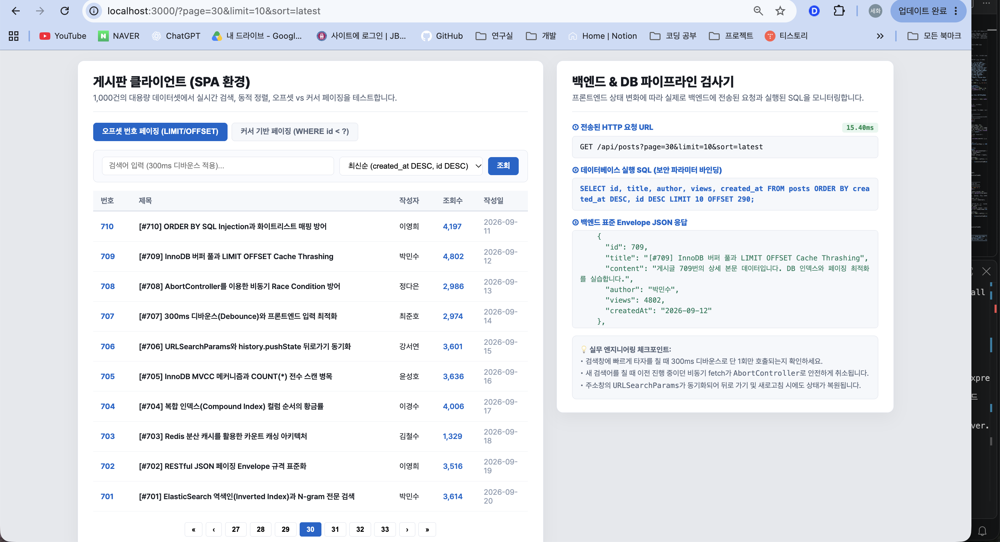

- 파일명: fig01_initial_board.png
- 촬영 내용: Node.js 서버 실행 후 게시판 초기 화면
- 테스트 목적: 기본 게시글 목록 및 API 응답 확인
- 확인 항목:
  - 최초 게시글 10개 표시
  - 기본 정렬 latest
  - 현재 페이지 1
  - HTTP 요청 및 JSON 응답 표시
- 기대 결과: 게시판 접속 시 기본 정렬(latest)이 적용된 게시글 10개가 첫 페이지에 표시되고, HTTP 요청 및 JSON 응답이 정상적으로 출력되어야 함.
- 실제 결과: 게시판 최초 접속 시 게시글 10개가 정상적으로 표시되었으며, 기본 정렬 latest와 현재 페이지 1이 적용됨. 우측 검사기에서도 HTTP 요청 URL 및 JSON 응답이 정상적으로 표시됨.
- 판정: **성공**

## 그림 2. 기존 게시판 제목 검색 검증

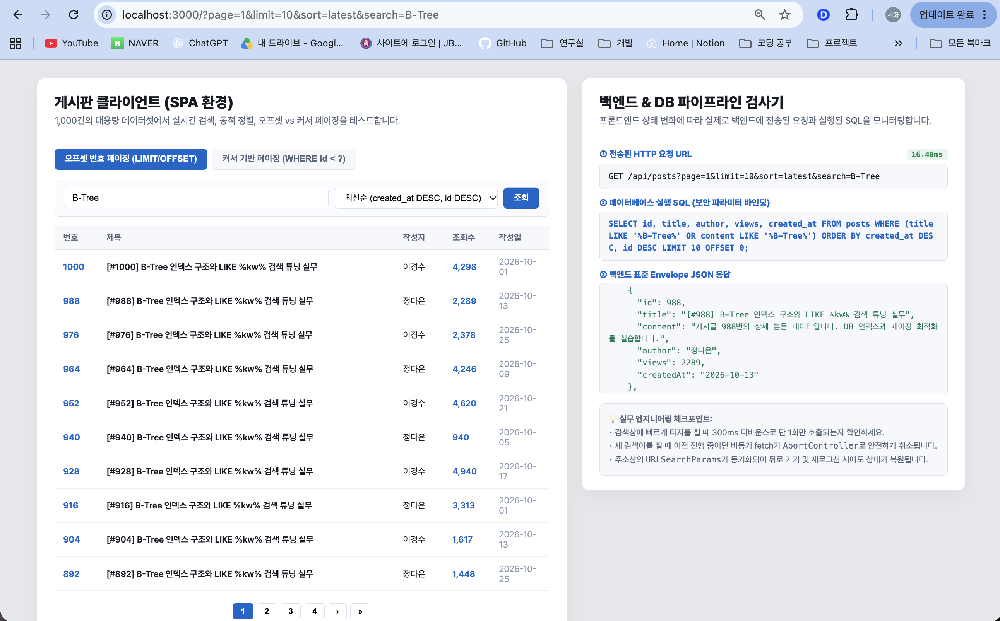

- 검색어: B-Tree
- 테스트 목적: 제목에 검색어가 포함된 게시글 조회
- 기대 결과: 검색어가 포함된 게시글만 표시
- 실제 결과: B-Tree가 포함된 게시글 10개가 첫 페이지에 표시됨
- API 요청: GET /api/posts?page=1&limit=10&sort=latest&search=B-Tree
- 판정: 성공

## 그림 3. 검색 결과 없음 처리 검증

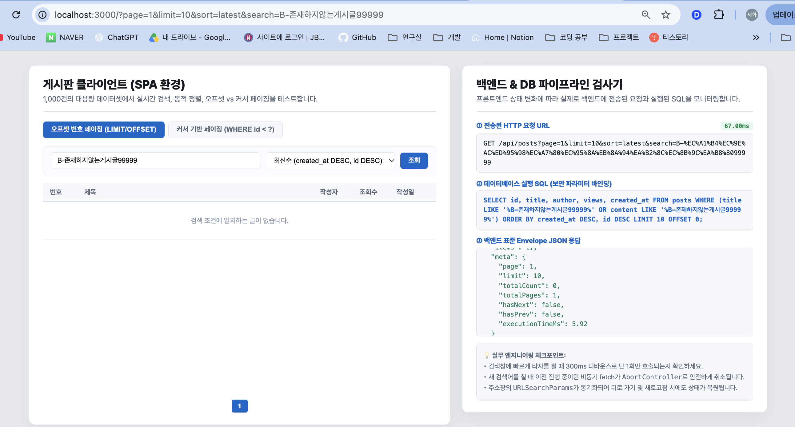

- 파일명: fig03_search_empty.png
- 촬영 내용: 존재하지 않는 검색어 입력 시 게시판 화면
- 테스트 목적: 검색 결과가 없는 상황의 예외 처리 검증
- 검색어: B-존재하지않는게시글99999
- 기대 결과:
  - 검색 결과 0개
  - 검색 결과 없음 안내 메시지 표시
  - JSON 응답의 items가 빈 배열로 반환
  - meta.totalCount가 0으로 반환
  - 페이지네이션이 1페이지로 처리
- 실제 결과:
  - 게시글 목록에 "검색 조건에 일치하는 글이 없습니다." 메시지가 표시됨
  - JSON 응답에서 items가 빈 배열로 반환됨
  - meta.totalCount는 0, meta.totalPages는 1로 확인됨
  - meta.hasNext와 meta.hasPrev가 모두 false로 반환됨
  - 검색 결과가 없어도 서버 오류 없이 정상 처리됨
- 판정: **성공**

## 그림 4. 게시글 본문 검색 기능 검증

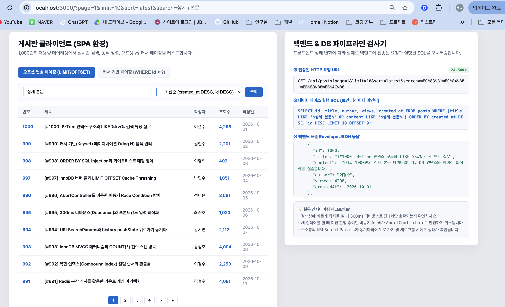

- 파일명: fig04_search_body.png
- 촬영 내용: 게시글 본문에 포함된 검색어 조회 화면
- 테스트 목적: 제목이 아닌 본문에 포함된 검색어로 게시글을 검색할 수 있는지 확인
- 검색어: 상세 본문
- 기대 결과:
  - 본문에 검색어가 포함된 게시글 반환
  - 전체 검색 결과 1,000개
  - 첫 페이지 게시글 10개 표시
  - meta.totalCount = 1000
  - meta.totalPages = 100

- 실제 결과:
  - 게시글 제목에 검색어가 없어도 본문에 포함된 게시글이 정상 조회됨
  - 첫 페이지에서 게시글 10개가 표시됨
  - JSON 응답의 content에 "상세 본문"이 포함됨
  - meta.totalCount = 1000
  - meta.totalPages = 100
  - meta.page = 1
  - meta.hasNext = true
  - meta.hasPrev = false
  - 검색어가 HTTP 요청 URL에 정상 전달됨
- 판정: **성공**

## 그림 5. 기존 게시판 최신순 정렬 검증

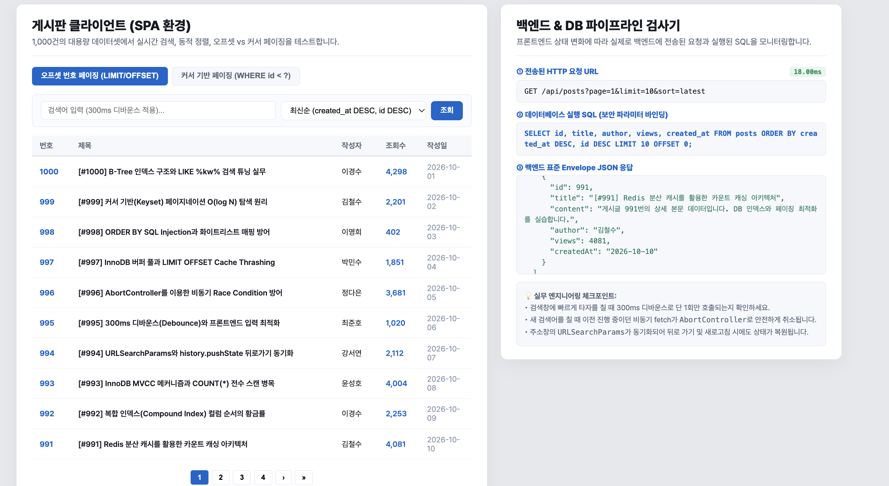

- 파일명: fig05_sort_latest.png
- 촬영 내용: 최신순 정렬 적용 후 게시글 목록
- 테스트 목적: 최신순 정렬 기능의 정상 동작 여부 확인
- 정렬 기준: latest

- 기대 결과:
  - 작성일(createdAt) 내림차순 정렬
  - 작성일이 같으면 id 내림차순 정렬
  - 정렬 변경 시 1페이지 표시

- 실제 결과:
  - HTTP 요청에 sort=latest가 정상 전달됨
  - 첫 페이지에 게시글 10개 표시
  - 게시글 ID는 1000부터 991까지 내림차순 정렬됨
  - 작성일은 2026-10-01부터 2026-10-10까지 오름차순으로 표시됨
  - 실제 코드가 작성일이 아닌 ID만 기준으로 정렬함

- 발견된 문제:
  - 화면의 최신순 표시와 실제 정렬 결과가 불일치함
  - 백엔드 정렬 로직의 개선이 필요함

- 판정: **개선 필요**

## 그림 6. 기존 게시판 오래된순 정렬 검증

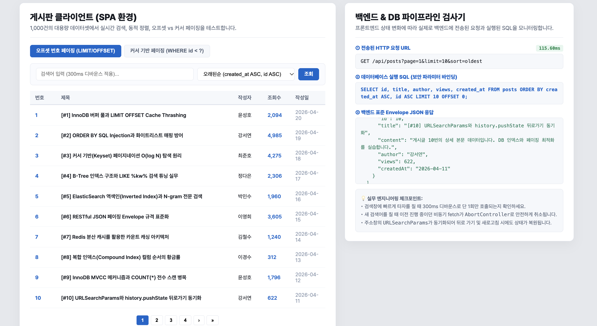

- 파일명: fig06_sort_oldest.png
- 촬영 내용: 오래된순 정렬 적용 후 게시글 목록
- 테스트 목적: 작성일 기준 오름차순 정렬 검증
- 정렬 기준: oldest

- 기대 결과:
  - 작성일(createdAt) 오름차순 정렬
  - 작성일이 같으면 id 오름차순 정렬
  - 정렬 변경 시 1페이지로 초기화

- 실제 결과:
  - HTTP 요청에 sort=oldest가 정상 전달됨
  - 첫 페이지에 게시글 10개 표시
  - 게시글 ID는 1부터 10까지 오름차순 정렬됨
  - 작성일은 2026-04-20부터 2026-04-11까지 내림차순으로 표시됨
  - 서버가 작성일이 아닌 ID를 기준으로 정렬하고 있음을 확인함

- 발견된 문제:
  - 오래된순 정렬 결과가 실제 작성일 기준과 불일치함
  - SQL 미리보기와 실제 백엔드 정렬 로직이 일치하지 않음
  - 작성일 기준 정렬 및 동점 시 ID 정렬 로직 개선 필요

- 판정: **개선 필요**

## 그림 7. 기존 게시판 조회수순 정렬 검증

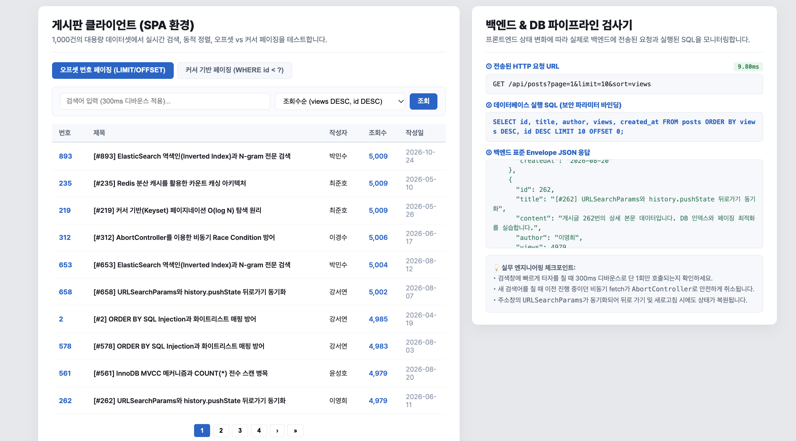

- 파일명: fig07_sort_views.png
- 촬영 내용: 조회수순 정렬 적용 후 게시글 목록
- 테스트 목적: 조회수 내림차순 및 동점 처리 검증
- 정렬 기준: views

- 기대 결과:
  - 조회수(views) 내림차순 정렬
  - 조회수가 같으면 id 내림차순 정렬
  - 정렬 변경 시 1페이지로 초기화
  - 첫 페이지 게시글 10개 표시

- 실제 결과:
  - HTTP 요청에 sort=views가 정상 전달됨
  - 첫 페이지에 게시글 10개가 표시됨
  - 조회수가 높은 게시글부터 내림차순으로 정렬됨
  - 조회수 5,009인 게시글이 ID 893 → 235 → 219 순서로 표시됨
  - 조회수 4,979인 게시글도 ID 561 → 262 순서로 표시됨
  - 조회수 동점 시 ID 내림차순 정렬이 정상 적용됨
  - 정렬 변경 후 현재 페이지가 1로 초기화됨

- 판정: **성공**

## 그림 8. 잘못된 정렬 키 처리 검증

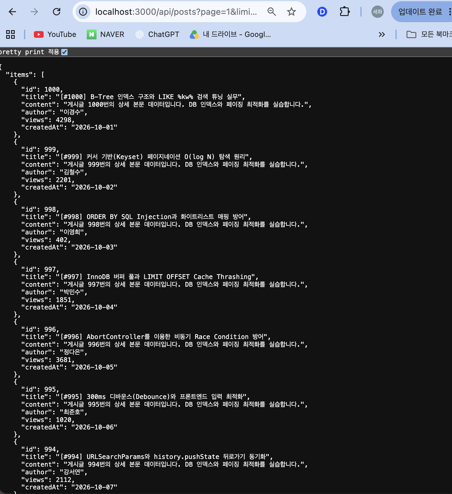

- 파일명: fig08_sort_invalid.png
- 촬영 내용: 허용되지 않은 정렬 키를 전달한 API 응답
- 테스트 목적: 잘못된 정렬 키의 기본값 처리 검증
- 테스트 URL: /api/posts?page=1&limit=10&sort=invalid

- 기대 결과:
  - 허용되지 않은 정렬 키를 latest로 처리
  - 서버 오류 없이 JSON 응답 반환
  - 원본 기준 게시글 ID 1000부터 991까지 내림차순 정렬

- 실제 결과:
  - sort=invalid 요청 시 서버에서 정상 JSON 응답 반환
  - 게시글 ID가 1000부터 991까지 내림차순으로 반환됨
  - meta.page = 1
  - meta.limit = 10
  - meta.totalCount = 1000
  - meta.totalPages = 100
  - 잘못된 정렬 키 입력 시 원본 latest 정렬과 동일하게 처리됨

- 판정: **성공**

## 그림 9. __proto__ 상속 속성 보안 검증

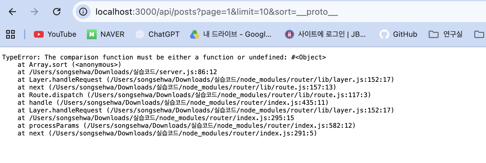

- 파일명: fig09_sort_proto.png
- 촬영 내용: __proto__ 정렬 키 입력 시 발생한 서버 오류
- 테스트 목적: 정렬 화이트리스트의 상속 속성 차단 여부 확인
- 테스트 URL: /api/posts?page=1&limit=10&sort=__proto__

- 기대 결과:
  - 허용되지 않은 정렬 키를 latest로 대체
  - 서버 오류 없이 정상 JSON 응답 반환
  - 상속 속성 접근 차단

- 실제 결과:
  - __proto__ 입력 시 TypeError 발생
  - Array.sort()에 올바른 비교 함수가 전달되지 않음
  - 정상 JSON 응답 반환에 실패함
  - server.js 86번째 줄에서 오류 발생 확인

- 발견된 문제:
  - SORT_WHITELIST[sortKey] 접근 시 상속 속성이 차단되지 않음
  - __proto__를 통해 객체가 정렬 함수로 선택됨
  - Object.hasOwn() 등을 이용한 명시적인 검증 필요

- 판정: **개선 필요**

## 그림 10. constructor 상속 속성 보안 검증

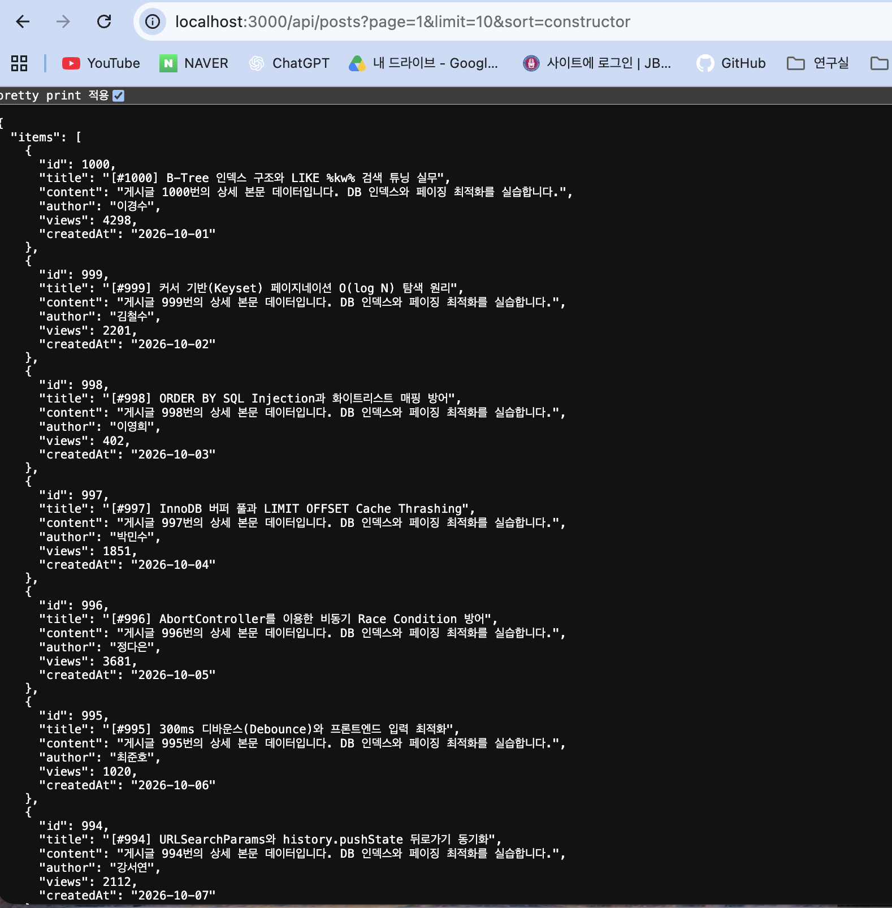

- 파일명: fig10_sort_constructor.png
- 촬영 내용: constructor 정렬 키 입력 시 서버 JSON 응답
- 테스트 목적: 정렬 화이트리스트의 상속 속성 차단 여부 확인
- 테스트 URL: /api/posts?page=1&limit=10&sort=constructor

- 기대 결과:
  - 허용되지 않은 정렬 키를 latest로 대체
  - 상속 속성이 정렬 함수로 선택되지 않도록 차단
  - 서버 오류 없이 정상 JSON 응답 반환

- 실제 결과:
  - 서버 오류 없이 JSON 응답이 반환됨
  - 게시글 ID가 1000, 999, 998 순서로 표시됨
  - 화면상 기본 latest 정렬과 동일한 결과를 보임
  - 그러나 constructor 상속 속성이 차단되지 않음
  - 기본 정렬 함수 대신 Object 생성자 함수가 선택됨
  - 원본 배열 순서가 유지되어 문제가 드러나지 않음

- 발견된 문제:
  - SORT_WHITELIST[sortKey] 접근 시 상속 속성을 허용함
  - 정상 응답만으로 화이트리스트 보안을 보장할 수 없음
  - Object.hasOwn()을 이용한 명시적 검증 필요

- 판정: **개선 필요**

## 그림 11. 오프셋 페이지네이션 page=0 검증

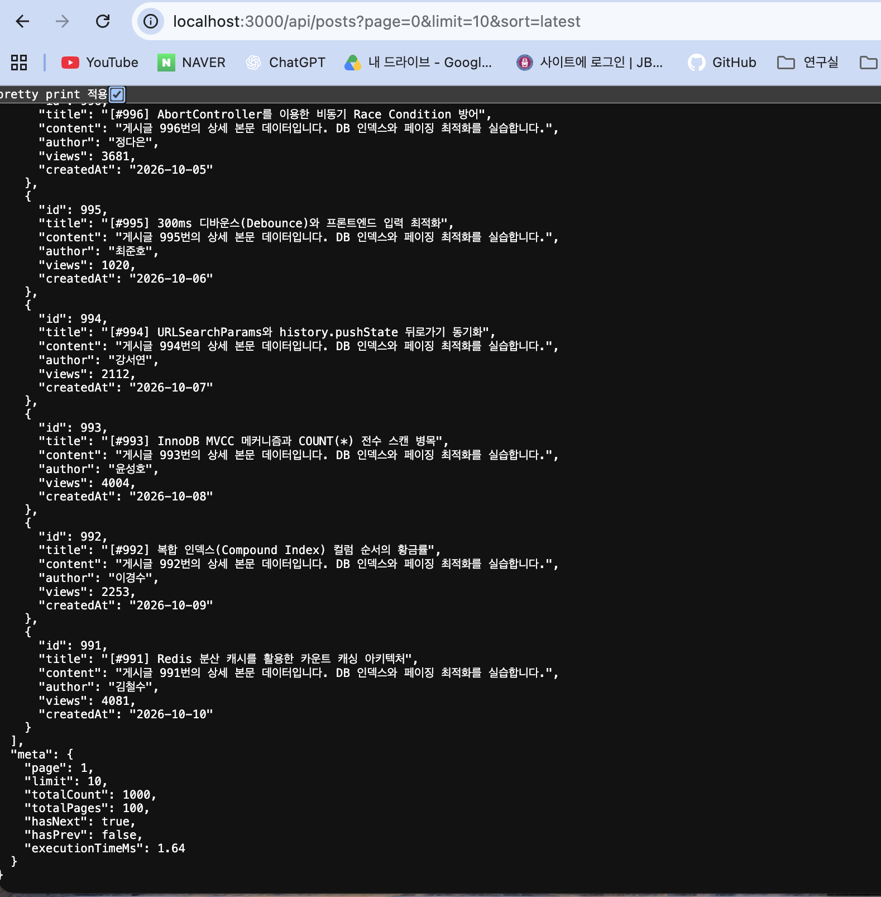

- 파일명: fig11_offset_page_zero.png
- 촬영 내용: 잘못된 페이지 번호(page=0) 입력 시 API 응답
- 테스트 목적: 유효하지 않은 페이지 번호의 기본값 처리 확인
- 테스트 URL: /api/posts?page=0&limit=10&sort=latest

- 기대 결과:
  - page=0을 1페이지로 보정
  - meta.page = 1
  - meta.limit = 10
  - 게시글 10개 정상 반환
  - 서버 오류 없이 JSON 응답 반환

- 실제 결과:
  - page=0 요청 시 백엔드가 1페이지로 보정함
  - meta.page = 1
  - meta.limit = 10
  - meta.totalCount = 1000
  - meta.totalPages = 100
  - 게시글 ID 1000~991까지 총 10개 반환
  - 서버 오류 없이 정상 JSON 응답 확인

- 판정: **성공**

## 그림 12. 오프셋 페이지네이션 page=-1 검증

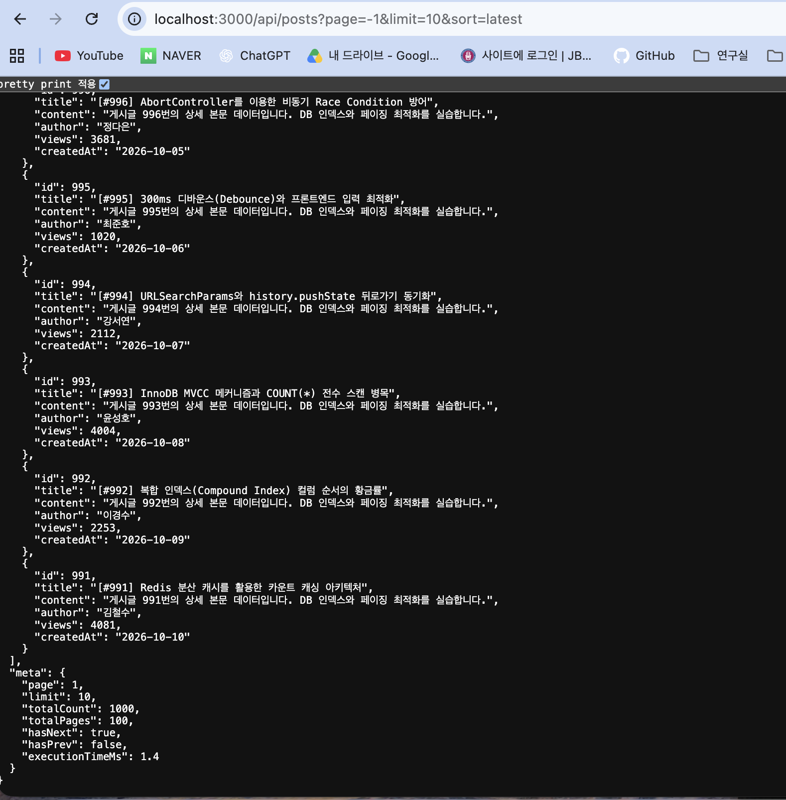

- 파일명: fig12_offset_page_negative.png
- 촬영 내용: 음수 페이지 번호 요청 시 API 응답
- 테스트 목적: 음수 페이지 입력에 대한 방어 처리 검증
- 테스트 URL: /api/posts?page=-1&limit=10&sort=latest

- 기대 결과:
  - 음수 페이지를 기본값 1로 보정
  - meta.page = 1
  - 게시글 10개 정상 반환
  - 서버 오류 없이 JSON 응답 반환

- 실제 결과:
  - page=-1 요청 시 서버 오류 없이 정상 JSON 응답 반환
  - 음수 페이지 번호가 기본값 1로 보정됨
  - meta.page = 1
  - meta.limit = 10
  - meta.totalCount = 1000
  - meta.totalPages = 100
  - meta.hasNext = true
  - meta.hasPrev = false
  - 게시글 ID 1000~991까지 총 10개 반환

- 판정: **성공**

## 그림 13. 오프셋 페이지네이션 page=abc 검증

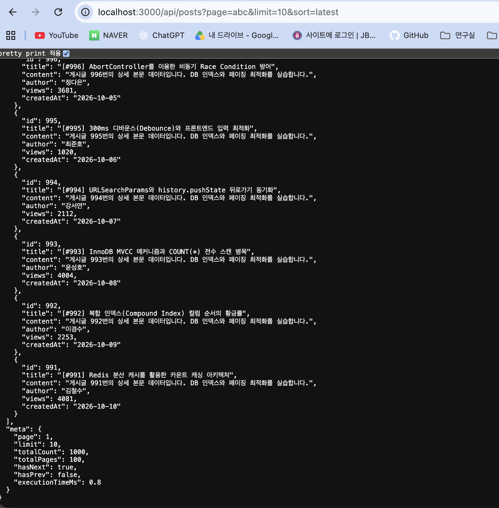

- 파일명: fig13_offset_page_abc.png
- 촬영 내용: 문자 페이지 번호 요청 시 API 응답
- 테스트 목적: 숫자가 아닌 페이지 입력에 대한 방어 처리 검증
- 테스트 URL: /api/posts?page=abc&limit=10&sort=latest

- 기대 결과:
  - page=abc를 기본값 1로 보정
  - meta.page = 1
  - 게시글 10개 정상 반환
  - 서버 오류 없이 JSON 응답 반환

- 실제 결과:
  - page=abc 요청 시 서버 오류 없이 정상 JSON 응답 반환
  - 숫자가 아닌 페이지 번호가 기본값 1로 보정됨
  - meta.page = 1
  - meta.limit = 10
  - meta.totalCount = 1000
  - meta.totalPages = 100
  - meta.hasNext = true
  - meta.hasPrev = false
  - 게시글 ID 1000~991까지 총 10개 반환

- 판정: **성공**

## 그림 14. 오프셋 페이지네이션 limit=1000 검증

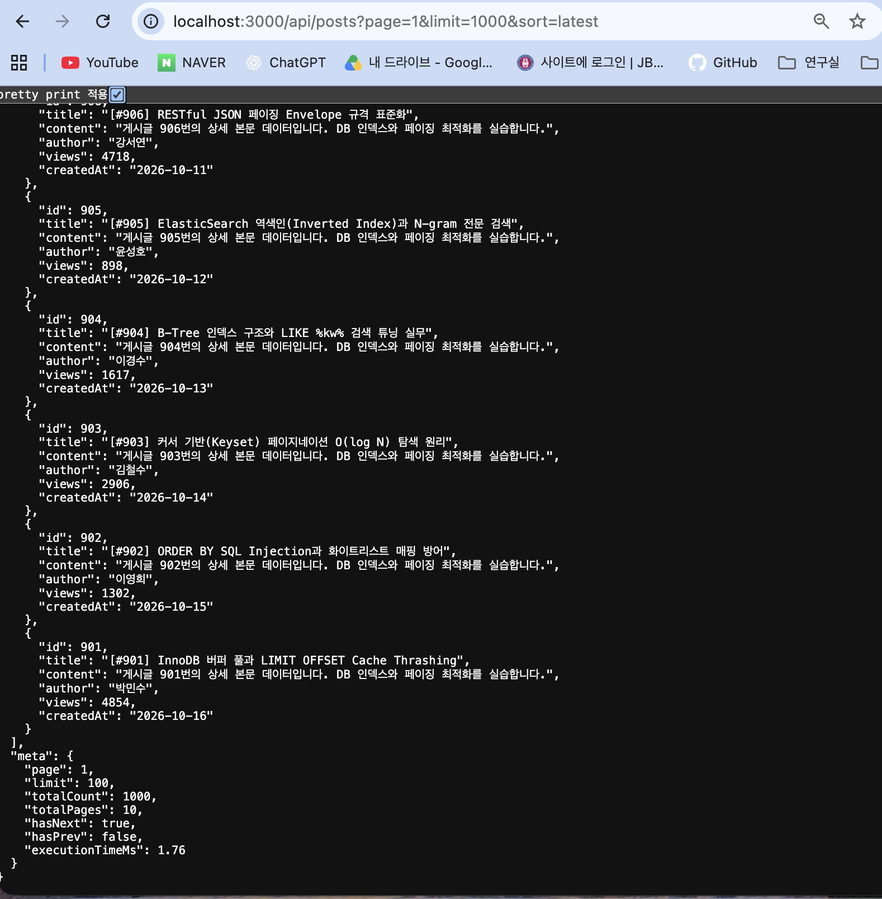

- 파일명: fig14_offset_limit_1000.png
- 촬영 내용: 대량 게시글 조회 요청 시 서버 제한 처리
- 테스트 목적: 한 페이지 최대 조회 개수 제한 검증
- 테스트 URL: /api/posts?page=1&limit=1000&sort=latest

- 실제 결과:
  - limit=1000 요청 시 서버가 최대 100개로 제한함
  - meta.page = 1
  - meta.limit = 100
  - meta.totalCount = 1000
  - meta.totalPages = 10
  - meta.hasNext = true
  - meta.hasPrev = false
  - 게시글 ID 1000~901까지 총 100개 반환
  - 서버 오류 없이 정상 JSON 응답 확인

- 판정: **성공**

## 그림 15. 오프셋 페이지 이동 검증

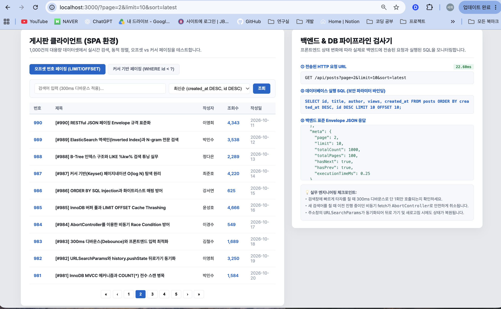

- 파일명: fig15_offset_page2.png
- 촬영 내용: 게시판 1페이지에서 2페이지로 이동한 화면
- 테스트 목적: 오프셋 계산 및 페이지 이동 기능 검증

- 테스트 조건:
  - 정렬 기준: latest
  - 검색어: 없음
  - 페이지당 게시글: 10개
  - 이동 페이지: 2

- 실제 결과:
  - 2페이지 버튼 클릭 시 게시글 목록 정상 변경
  - HTTP 요청에 page=2&limit=10&sort=latest 전달
  - 게시글 ID 990~981까지 총 10개 표시
  - SQL 미리보기에서 LIMIT 10 OFFSET 10 확인
  - meta.page = 2
  - meta.limit = 10
  - meta.totalCount = 1000
  - meta.totalPages = 100
  - meta.hasPrev = true
  - meta.hasNext = true
  - 오프셋 계산 결과와 실제 게시글 목록 일치

- 판정: **성공**

## 그림 16. 오프셋 마지막 페이지 검증

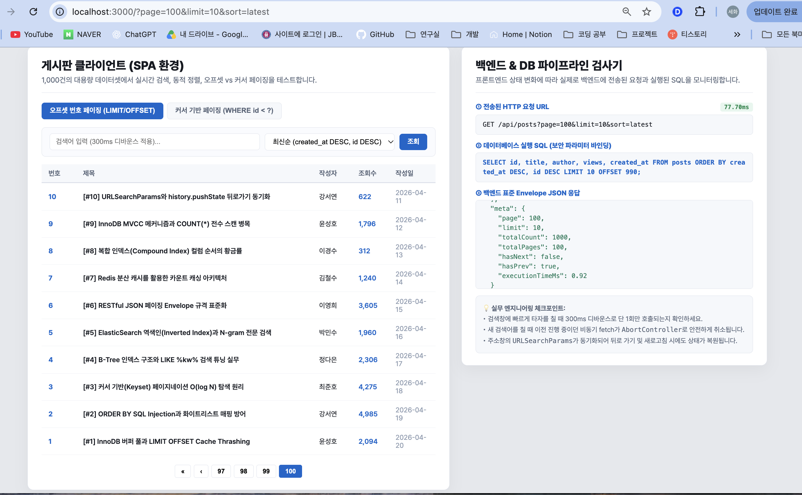

- 파일명: fig16_offset_last_page.png
- 촬영 내용: 마지막 페이지(100페이지) 이동 화면
- 테스트 목적: 마지막 페이지 이동 및 경계 처리 검증

- 기대 결과:
  - 100페이지로 정상 이동
  - offset = (100 - 1) × 10 = 990
  - 게시글 ID 10~1 표시
  - meta.page = 100
  - meta.totalPages = 100
  - meta.hasNext = false
  - meta.hasPrev = true

- 실제 결과:
  - 마지막 페이지 이동 버튼 클릭 시 100페이지로 정상 이동함
  - 100페이지 버튼이 활성화됨
  - HTTP 요청에 page=100&limit=10&sort=latest가 전달됨
  - 게시글 ID 10~1까지 총 10개 표시됨
  - SQL 미리보기에서 LIMIT 10 OFFSET 990 확인
  - meta.page = 100
  - meta.limit = 10
  - meta.totalCount = 1000
  - meta.totalPages = 100
  - meta.hasNext = false
  - meta.hasPrev = true
  - 마지막 페이지에서 다음 페이지 이동 버튼이 표시되지 않음

- 판정: **성공**

## 그림 17. 검색어 변경 시 페이지 초기화 검증

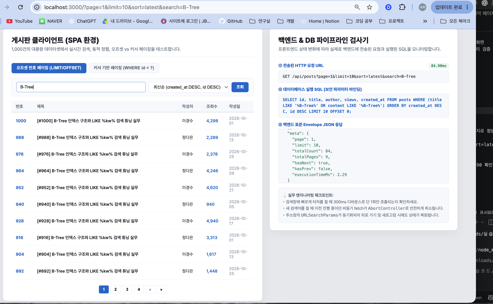

- 파일명: fig17_search_page_reset.png
- 촬영 내용: 100페이지에서 검색어 변경 후 1페이지로 초기화된 화면
- 테스트 목적: 검색 조건 변경 시 페이지 상태 초기화 검증

- 테스트 조건:
  - 검색 전 페이지: 100
  - 검색어: B-Tree
  - 정렬 기준: latest

- 기대 결과:
  - 검색어 변경 시 현재 페이지가 1로 초기화됨
  - URL에 page=1 및 search=B-Tree 반영
  - 검색 조건에 맞는 게시글만 표시됨

- 실제 결과:
  - 100페이지에서 B-Tree 검색어 입력 후 1페이지로 자동 초기화됨
  - URL에 page=1&limit=10&sort=latest&search=B-Tree 반영
  - B-Tree가 포함된 게시글만 조회됨
  - 첫 페이지 게시글 10개 정상 표시
  - meta.page = 1
  - meta.limit = 10
  - meta.totalCount = 84
  - meta.totalPages = 9
  - meta.hasNext = true
  - meta.hasPrev = false
  - 검색 조건 변경에 따른 페이지 초기화 및 전체 페이지 수 재계산 확인

- 판정: **성공**

## 그림 18. 정렬 변경 시 페이지 초기화 검증

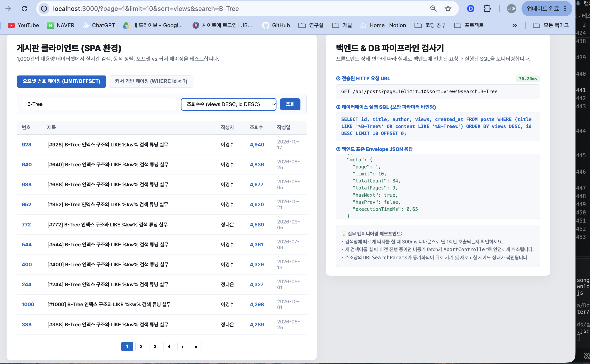

- 파일명: fig18_sort_page_reset.png
- 촬영 내용: 2페이지에서 조회수순으로 정렬 변경한 화면
- 테스트 목적: 정렬 변경 시 페이지 초기화 및 기존 검색 조건 유지 검증

- 기대 결과:
  - 정렬 변경 시 1페이지로 초기화
  - 기존 검색어 B-Tree 유지
  - URL에 page=1과 sort=views 반영
  - 조회수 내림차순 정렬 적용

- 실제 결과:
  - B-Tree 검색 결과의 2페이지에서 조회수순으로 정렬 변경
  - 정렬 변경 후 현재 페이지가 1로 자동 초기화됨
  - 기존 검색어 B-Tree가 유지됨
  - URL에 page=1&limit=10&sort=views&search=B-Tree 반영
  - HTTP 요청에 동일한 파라미터가 정상 전달됨
  - meta.page = 1
  - meta.limit = 10
  - meta.totalCount = 84
  - meta.totalPages = 9
  - meta.hasNext = true
  - meta.hasPrev = false
  - 조회수 내림차순 정렬이 정상 적용됨

- 판정: **성공**

## 그림 19. 커서 기반 페이지네이션 최초 조회 검증

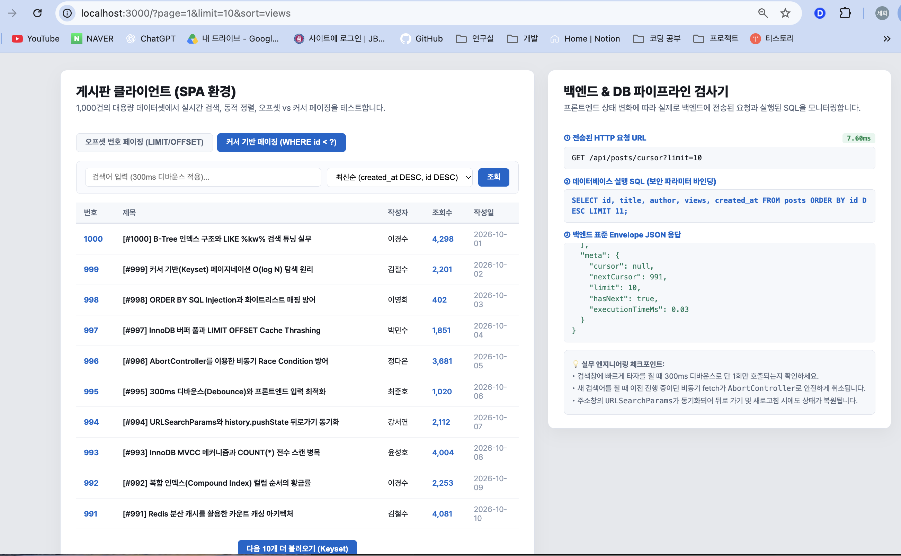

- 파일명: fig19_cursor_initial.png
- 촬영 내용: 커서 기반 페이지네이션 최초 조회 화면
- 테스트 목적: 커서 API의 초기 데이터 조회, 다음 커서 생성 및 커서 모드 UI 상태 확인
- 테스트 API: GET /api/posts/cursor?limit=10

### 기대 결과
- 커서 모드 전환 시 게시글 10개가 정상 표시됨
- 게시글 ID 1000~991까지 내림차순으로 반환됨
- `meta.cursor = null`
- `meta.nextCursor = 991`
- `meta.limit = 10`
- `meta.hasNext = true`
- 다음 10개 더 불러오기 버튼이 표시됨

### 실제 결과
- 커서 기반 페이지네이션 모드로 정상 전환됨
- 우측 패널에서 `GET /api/posts/cursor?limit=10` 요청 확인
- SQL 미리보기에서 `ORDER BY id DESC LIMIT 11` 확인
- 게시글 ID 1000~991까지 총 10개 표시됨
- `meta.cursor = null` 확인
- `meta.nextCursor = 991` 확인
- `meta.limit = 10` 확인
- `meta.hasNext = true` 확인
- 하단에 `다음 10개 더 불러오기 (Keyset)` 버튼이 정상 표시됨

### 발견된 문제
- 브라우저 주소창에는 `?page=1&limit=10&sort=views`가 남아 있지만, 실제 요청은 `/api/posts/cursor?limit=10`으로 전송됨
- 화면의 주소 상태와 실제 커서 API 요청 정보가 완전히 일치하지 않음
- 커서 모드에서도 정렬 드롭다운이 표시되어 사용자가 실제 정렬 기준이 적용되는 것으로 오해할 수 있음
- 실제 커서 API는 `ORDER BY id DESC` 기준으로 동작하므로, 커서 모드에서는 정렬 UI 비활성화 또는 기준 고정 안내가 필요함

### 판정
**최초 조회 성공 (주소 상태 및 정렬 UI 개선 필요)**

## 그림 20. 커서 기반 페이지네이션 더 보기 검증

### 그림 20-1. 커서 API 응답
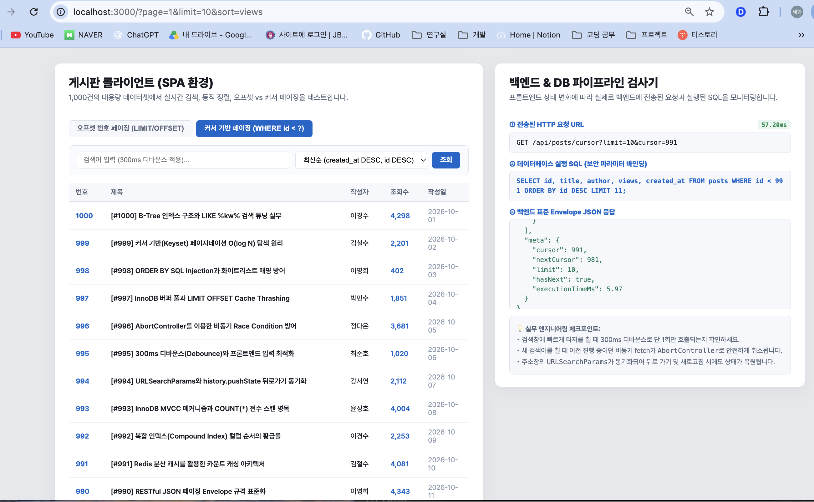

### 그림 20-2. 게시글 누적 결과
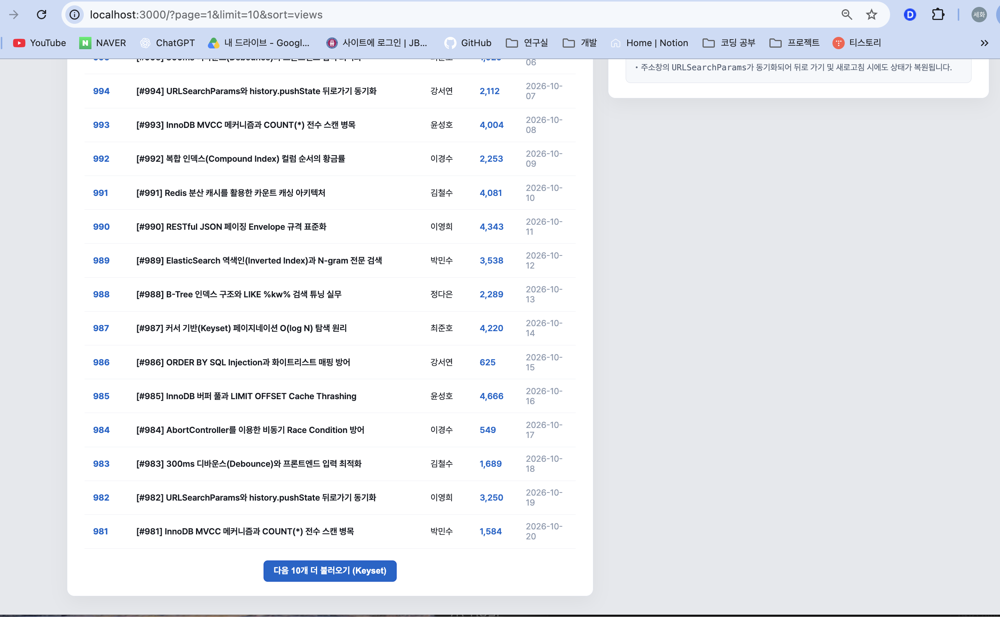

- 테스트 목적: 커서 갱신 및 게시글 누적 기능 검증
- 테스트 API: GET /api/posts/cursor?limit=10&cursor=991

### 기대 결과
- 기존 게시글 ID 1000~991 유지
- 추가 게시글 ID 990~981 표시
- 총 20개 게시글 누적
- meta.cursor = 991
- meta.nextCursor = 981
- meta.hasNext = true
- 누락 및 중복 없음

### 실제 결과
- cursor=991을 이용한 두 번째 API 요청 정상 실행
- JSON 응답에서 nextCursor=981 확인
- 기존 게시글 ID 1000~991 유지
- 새로운 게시글 ID 990~981 추가
- 총 20개 게시글이 순서대로 표시됨
- 확인한 20개 게시글에서 누락 및 중복 없음
- 더 보기 버튼이 활성화된 상태로 유지됨

### 판정
**성공**

## 그림 21. 커서 기반 페이지네이션 마지막 데이터 검증

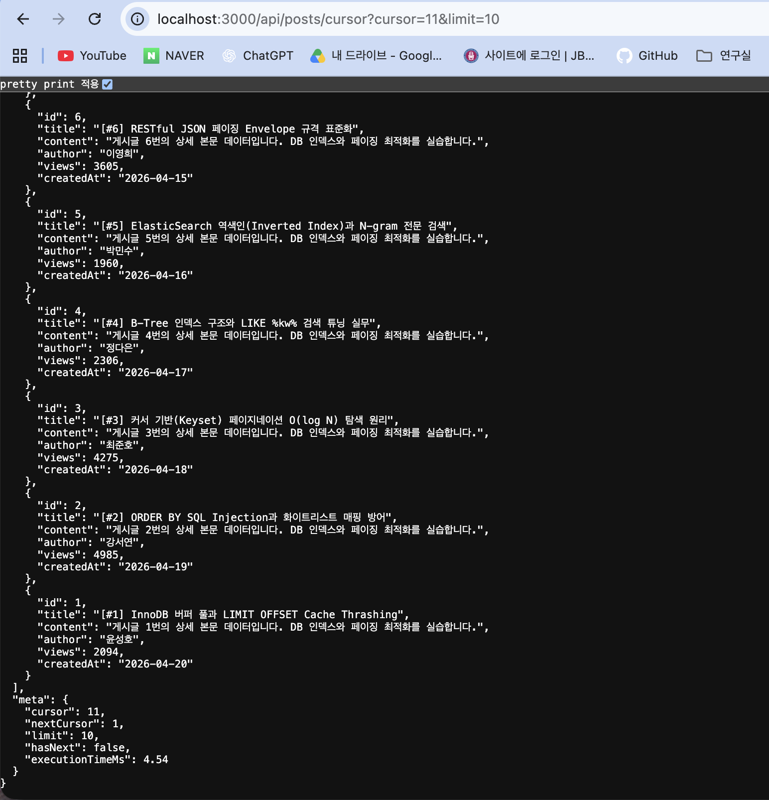

- 파일명: fig21_cursor_last_page.png
- 촬영 내용: 마지막 커서 데이터 조회 시 JSON 응답
- 테스트 목적: 마지막 데이터 조회 및 hasNext=false 처리 검증
- 테스트 API: GET /api/posts/cursor?cursor=11&limit=10

### 기대 결과
- ID 10~1까지 총 10개 게시글 반환
- meta.cursor = 11
- meta.nextCursor = 1
- meta.limit = 10
- meta.hasNext = false
- 서버 오류 없이 정상 JSON 응답 반환

### 실제 결과
- cursor=11 조건으로 마지막 게시글 데이터 조회
- JSON 응답에서 마지막 게시글 ID 1 확인
- meta.cursor = 11 확인
- meta.nextCursor = 1 확인
- meta.limit = 10 확인
- meta.hasNext = false 확인
- 추가 조회할 게시글이 없음을 정상적으로 반환함
- 서버 오류 없이 정상 JSON 응답 확인

### 판정
**성공**

## 그림 22. 커서 마지막 데이터 조회 후 더 보기 버튼 비활성화 검증

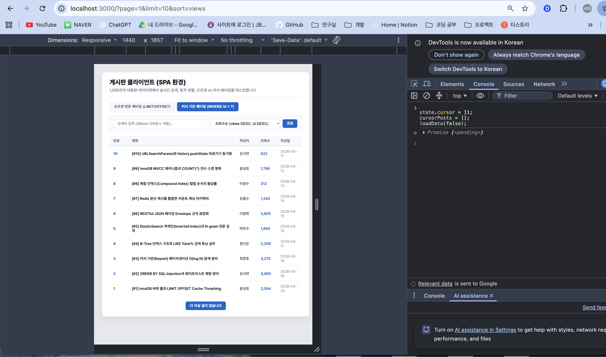

- 파일명: fig22_cursor_button_disabled.png
- 촬영 내용: 마지막 커서 조회 후 더 보기 버튼 상태
- 테스트 목적: hasNext=false 응답에 따른 프론트엔드 버튼 비활성화 처리 검증
- 테스트 방식: Chrome 개발자 도구를 이용한 마지막 커서 상황 재현

### 테스트 조건
- 페이지 모드: 커서 기반 페이지네이션
- 커서 값: 11
- 조회 개수: 10개
- 개발자 도구 실행 명령어:
  - state.cursor = 11
  - cursorPosts = []
  - loadData(false)

### 기대 결과
- 게시글 ID 10~1 반환
- meta.hasNext = false
- 마지막 게시글 조회 후 추가 데이터 요청 방지
- 더 보기 버튼 비활성화
- 버튼 문구를 "더 이상 글이 없습니다"로 변경

### 실제 결과
- 개발자 도구에서 마지막 커서 조건 설정 완료
- 게시글 ID 10~1까지 화면에 정상 표시됨
- 마지막 게시글 ID 1 확인
- 더 보기 버튼의 문구가 "더 이상 글이 없습니다"로 변경됨
- 원본 코드에서 hasNext=false일 때 버튼을 비활성화하는 로직 확인
- 서버 오류 없이 마지막 데이터 조회 결과가 표시됨

### 검증 범위
- 전체 1,000개 게시글을 순차적으로 조회한 것은 아님
- 개발자 도구로 마지막 커서 상황을 재현하여 버튼 상태를 확인함
- 비활성화 버튼 클릭 시 추가 HTTP 요청이 발생하지 않는지는 별도 확인하지 않음

### 판정
**성공 (마지막 커서 상황의 버튼 상태 처리 검증)**

## 그림 23. 커서 기반 페이지네이션 검색 기능 검증

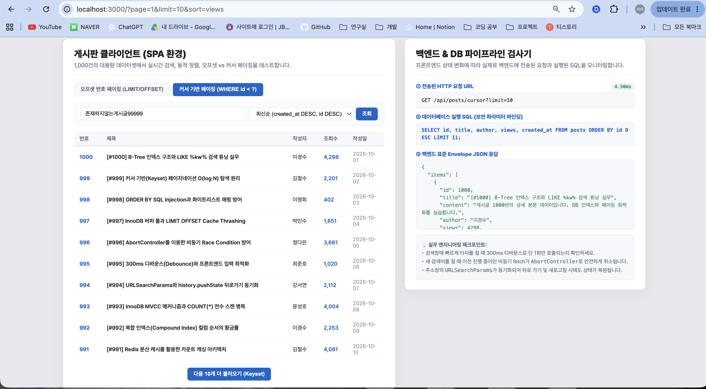

- 파일명: fig23_cursor_search_missing.png
- 촬영 내용: 커서 모드에서 존재하지 않는 검색어 입력 후 게시판 화면
- 테스트 목적: 커서 API의 제목·본문 검색 기능 적용 여부 확인
- 테스트 검색어: 존재하지않는게시글99999
- 테스트 모드: 커서 기반 페이지네이션

### 기대 결과
- 검색어가 커서 API 요청에 전달됨
- 제목 또는 본문에 검색어가 포함된 게시글만 반환
- 검색 결과가 없으므로 items = []
- meta.hasNext = false
- 게시판에 "검색 조건에 일치하는 글이 없습니다." 메시지 표시
- 검색 조건 변경 시 기존 누적 목록과 커서 초기화

### 실제 결과
- 커서 모드에서 검색어 입력 정상 확인
- HTTP 요청이 GET /api/posts/cursor?limit=10으로 전송됨
- API 요청에 search 파라미터가 포함되지 않음
- 검색 결과가 없어야 하지만 기존 게시글 ID 1000~991이 표시됨
- JSON 응답에서도 검색 조건과 관계없는 게시글이 반환됨
- 검색 결과 없음 안내 메시지가 표시되지 않음

### 발견된 문제
- index.html의 커서 요청 생성 과정에서 검색어 전달 누락
- server.js의 커서 API에 제목·본문 검색 로직 미구현
- 검색어 입력에도 불구하고 일반 게시글 목록이 반환됨
- 검색 조건을 적용한 뒤 limit + 1 방식으로 hasNext를 계산하도록 개선 필요

### 개선 방향
- 프론트엔드에서 커서 API 요청 시 search 파라미터 전달
- 백엔드에서 제목·본문 검색 조건 적용
- 검색 조건 변경 시 누적 목록과 커서 초기화
- 검색 결과가 없는 경우 빈 배열과 hasNext=false 반환

### 판정
**개선 필요 (커서 검색 기능 미구현)**

## 그림 24. 300ms 디바운스 기능 검증

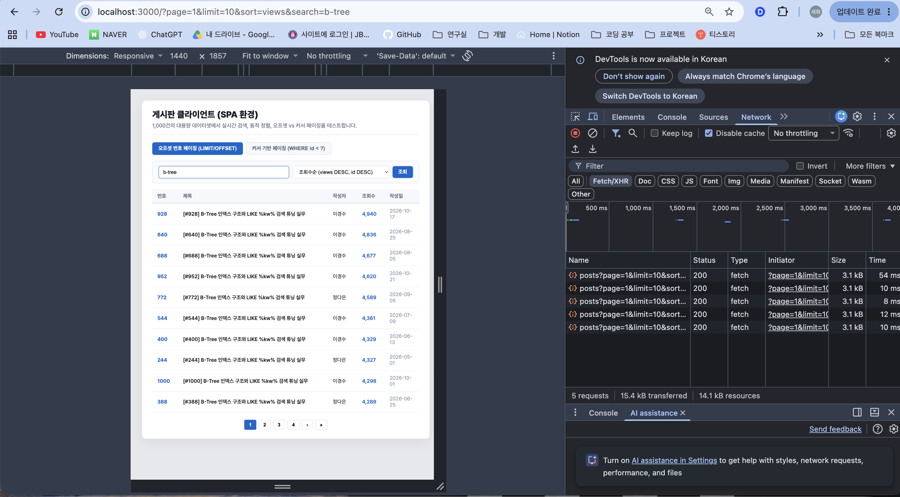

- 파일명: fig24_debounce_test.png
- 촬영 내용: 검색어 연속 입력 후 Chrome Network 요청 기록
- 테스트 목적: 300ms 디바운스 적용 여부 및 불필요한 API 요청 방지 확인
- 테스트 환경: Chrome 개발자 도구 Network → Fetch/XHR
- 테스트 검색어: b-tree

### 기대 결과
- 입력 간격이 300ms 미만인 연속 타이핑 후 API 요청 1회 발생
- 마지막 입력 후 300ms가 지나면 검색 요청 실행
- 최종 검색어가 API 요청에 반영됨
- 검색 조건에 맞는 게시글이 화면에 표시됨

### 실제 결과
- 검색창에 b-tree 입력 후 검색 결과 정상 표시
- Chrome Network에서 Fetch 요청 총 5건 확인
- 관찰된 요청 5건 모두 HTTP 200 응답
- Keep log 옵션이 해제된 상태에서 테스트 진행
- 주소창에 search=b-tree 파라미터 반영 확인
- 각 글자 입력 간격이 300ms 미만이었는지는 확인하지 못함
- 따라서 요청 5건 발생 원인이 입력 속도인지 코드 문제인지 확정할 수 없음

### 분석
- 원본 index.html에 300ms 디바운스 로직이 구현되어 있음
- 연속 입력 중 300ms 이상 멈추면 중간 검색 요청이 발생할 수 있음
- 정확한 입력 간격을 통제한 테스트가 추가로 필요함

### 판정
**검색 기능 정상 / 디바운스 요청 1회 조건 재검증 필요**

## 그림 25. AbortController 요청 취소 및 AbortError 안전 처리 검증

### 그림 25-1. 이전 HTTP 요청 취소 확인

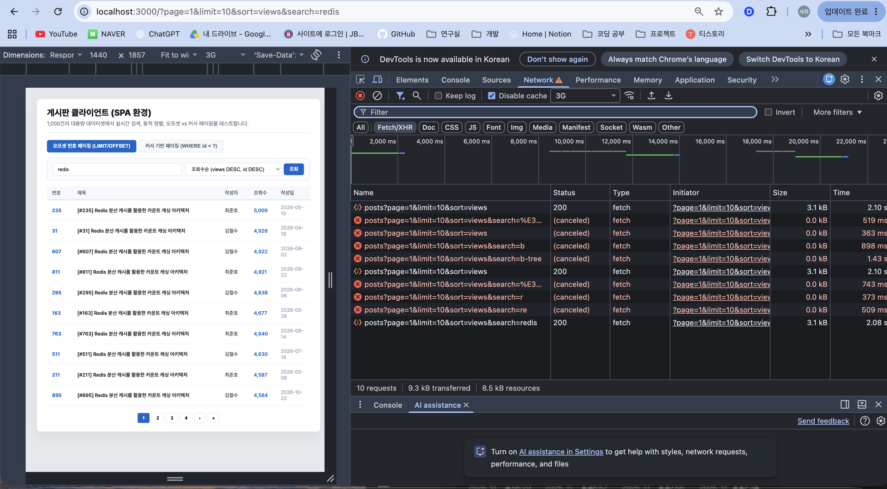

### 그림 25-2. AbortError 예외 처리 확인

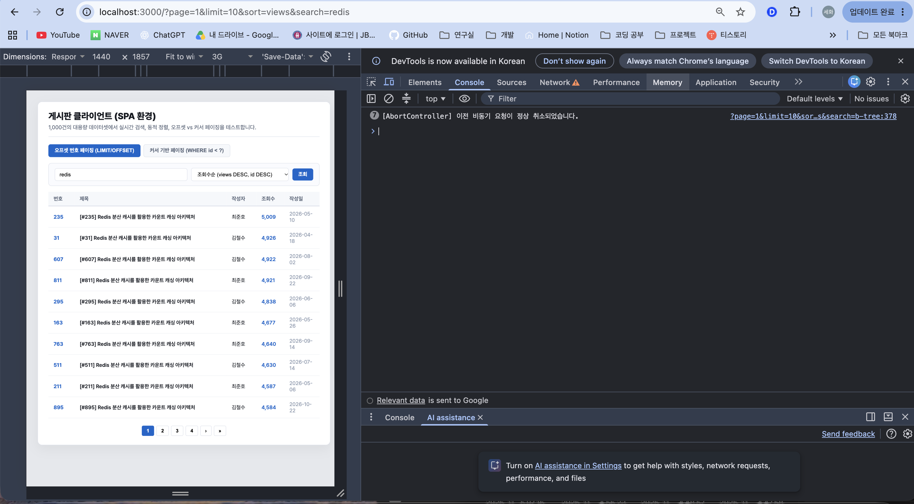

- 파일명:
  - fig25_abort_controller.png
  - fig25_abort_console.png
- 촬영 내용: 느린 네트워크 환경에서 검색어 변경 시 HTTP 요청 취소 및 Console 예외 처리 결과
- 테스트 목적: AbortController를 이용한 이전 비동기 요청 취소, AbortError 안전 처리 및 Race Condition 방어 검증
- 테스트 환경: Chrome DevTools Network 및 Console, 3G 네트워크
- 테스트 검색어: B-Tree → Redis

### 기대 결과
- B-Tree 검색 요청이 진행 중일 때 Redis 검색 실행
- 이전에 진행 중인 HTTP 요청 취소
- Network에서 취소된 요청이 canceled 상태로 표시
- 최종 Redis 검색 요청은 HTTP 200으로 정상 완료
- AbortError 발생 시 프로그램이 예외를 안전하게 처리
- 처리되지 않은 오류로 인한 화면 장애가 발생하지 않음
- 이전 응답이 최신 검색 결과를 덮어쓰지 않음
- 최종 Redis 검색 결과가 정상적으로 표시됨

### 실제 결과
- Chrome 개발자 도구에서 3G 네트워크 환경 적용
- B-Tree 검색 후 Redis 검색으로 변경
- Network에서 search=b-tree 요청이 canceled 상태로 표시됨
- 중간 검색 요청 search=r, search=re 등도 취소됨
- 최종 search=redis 요청은 HTTP 200으로 정상 완료됨
- Console에서 "[AbortController] 이전 비동기 요청이 정상 취소되었습니다." 로그 확인
- 동일한 취소 안내 메시지가 7회 묶여 표시됨
- 처리되지 않은 예외 메시지는 관찰되지 않음
- 주소창에 search=redis 파라미터가 정상 반영됨
- 게시판에 Redis 관련 게시글 10개가 표시됨
- 이전 검색 결과가 최종 Redis 검색 결과를 덮어쓰는 현상은 관찰되지 않음

### 분석
- 원본 index.html의 AbortController가 진행 중인 이전 HTTP 요청을 취소하는 것을 확인함
- AbortError를 일반 오류와 구분하여 처리하고 Console에 취소 안내 메시지를 출력함
- 최종 검색 요청이 정상 완료되어 최신 검색어에 해당하는 게시글이 유지됨
- 비동기 요청 간 응답 순서 차이로 인한 Race Condition을 방지하는 동작을 관찰함

### 판정
**성공 (이전 요청 취소, AbortError 안전 처리 및 최신 검색 결과 유지 확인)**

## 그림 26. URL 상태 복원 - 새로고침 검증

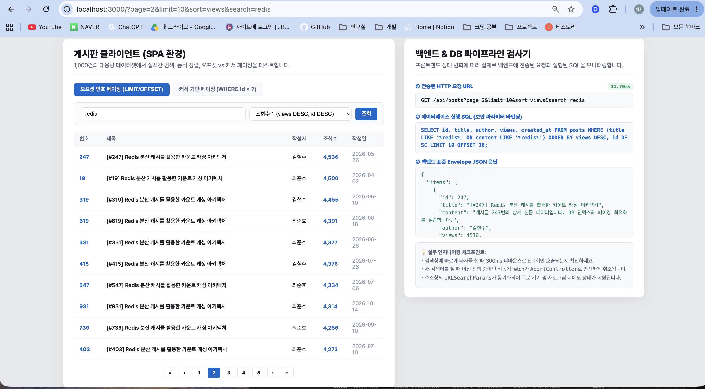

- 파일명: fig26_url_refresh_restore.png
- 촬영 내용: 검색·정렬·페이지 조건 설정 후 새로고침한 게시판 화면
- 테스트 목적: URLSearchParams를 이용한 검색어, 정렬 기준 및 페이지 상태 복원 확인
- 테스트 모드: 오프셋 번호 페이지네이션
- 테스트 조건: 검색어 redis, 조회수순(views), 2페이지

### 기대 결과
- 새로고침 후 검색어 redis 유지
- 정렬 기준 views 유지
- 현재 페이지 2 유지
- URL에 page=2&limit=10&sort=views&search=redis 반영
- Redis 검색 결과가 조회수 내림차순으로 표시
- 서버 오류 없이 게시판 정상 표시

### 실제 결과
- 새로고침 후 검색창에 redis가 유지됨
- 정렬 메뉴에서 조회수순(views)이 유지됨
- 페이지네이션에서 2페이지가 선택된 상태로 유지됨
- 주소창에 page=2&limit=10&sort=views&search=redis 확인
- HTTP 요청에서도 동일한 검색·정렬·페이지 파라미터 확인
- Redis 관련 게시글 10개가 정상 표시됨
- 조회수 내림차순 정렬 유지 확인
- 새로고침으로 인한 상태 초기화 또는 화면 오류가 발생하지 않음

### 판정
**성공 (검색어·정렬·페이지 상태 복원 확인)**

## 그림 27. 브라우저 뒤로 가기 URL 상태 복원 검증

- 파일명: fig27_url_popstate_restore.png
- 촬영 내용: 검색어 변경 후 브라우저 뒤로 가기를 실행하여 이전 검색 상태가 복원된 화면
- 테스트 목적: popstate 이벤트를 이용한 검색어·정렬·페이지 상태 복원 검증
- 테스트 모드: 오프셋 번호 페이지네이션

### 테스트 조건
- 이전 상태: redis 검색, 조회수순(views), 2페이지
- 변경 상태: B-Tree 검색, 조회수순(views), 1페이지
- 실행 동작: Chrome 브라우저 뒤로 가기 버튼 클릭

### 기대 결과
- 이전 검색어 redis 복원
- 정렬 기준 views 유지
- 이전 페이지 번호 2 복원
- URL에 page=2&limit=10&sort=views&search=redis 반영
- 이전 검색 조건에 해당하는 게시글 목록 표시
- 서버 오류 없이 정상 동작

### 실제 결과
- 브라우저 뒤로 가기 실행 후 검색창에 redis가 복원됨
- 정렬 메뉴에서 조회수순(views) 유지 확인
- 페이지네이션에서 2페이지가 활성화됨
- 주소창에 page=2&limit=10&sort=views&search=redis 표시
- HTTP 요청에 이전 검색·정렬·페이지 조건이 정상 전달됨
- Redis 관련 게시글 10개가 조회수 내림차순으로 표시됨
- URL과 화면 상태가 일치하는 것을 확인함
- 서버 오류 없이 이전 상태 복원 완료

### 분석
- popstate 이벤트를 통해 브라우저 히스토리 변경을 감지함
- URLSearchParams로 이전 URL의 검색어·정렬·페이지 값을 읽어 화면에 반영함
- 복원된 조건으로 API를 다시 호출하여 게시글 목록을 갱신함
- URL 상태와 화면 상태가 일치하도록 동기화되는 것을 확인함

### 판정
**성공 (뒤로 가기 시 검색어·정렬·페이지 및 게시글 목록 복원 확인)**

## 그림 28. __proto__ 정렬 보안 취약점 개선 후 검증

- 파일명: fig28_sort_proto_fixed.png
- 촬영 내용: __proto__ 정렬 키 입력 시 보안 개선 후 정상 JSON 응답
- 테스트 목적: Object.hasOwn()을 이용한 정렬 화이트리스트 보안 개선 효과 검증
- 테스트 API: GET /api/posts?page=1&limit=10&sort=__proto__

### 수정 전 문제
- SORT_WHITELIST[sortKey] 접근 시 상속 속성이 차단되지 않음
- __proto__ 입력 시 정렬 함수 대신 객체가 선택됨
- Array.sort()에서 TypeError 발생
- 정상 JSON 응답 반환 실패

### 수정 내용
- typeof sortKey === 'string' 조건으로 정렬 키의 자료형 확인
- Object.hasOwn(SORT_WHITELIST, sortKey)으로 직접 정의된 속성인지 검증
- 허용하지 않은 정렬 키는 latest를 기본 정렬로 적용

### 기대 결과
- __proto__ 정렬 키를 기본값 latest로 대체
- TypeError 발생 방지
- 게시글 ID 1000~991까지 정상 반환
- meta.page = 1
- meta.totalCount = 1000
- 서버 오류 없이 정상 JSON 응답

### 실제 결과
- __proto__ 요청 시 서버 오류 없이 정상 JSON 응답 반환
- 기존 TypeError가 발생하지 않음
- 게시글 ID 1000~991까지 내림차순 정렬됨
- meta.page = 1
- meta.limit = 10
- meta.totalCount = 1000
- meta.totalPages = 100
- 기본 정렬 latest와 동일한 결과 확인

### 판정
**성공 (__proto__ 정렬 보안 취약점 개선 확인)**

## 그림 29. constructor 정렬 보안 취약점 개선 후 검증

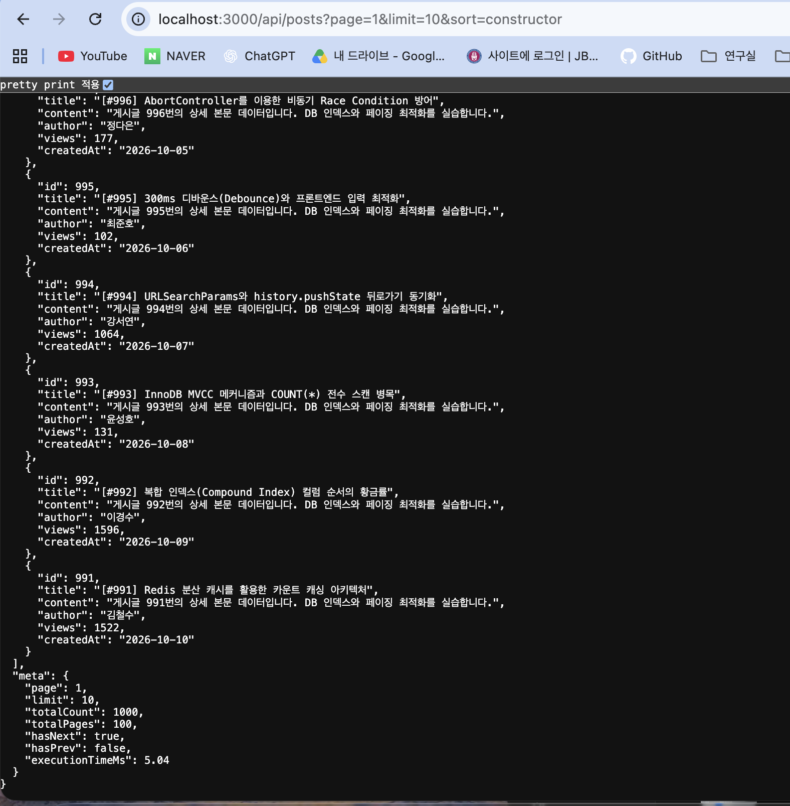

- 파일명: fig29_sort_constructor_fixed.png
- 촬영 내용: constructor 정렬 키 입력 시 보안 개선 후 정상 JSON 응답
- 테스트 목적: Object.hasOwn()을 이용한 상속 속성 차단 및 기본 정렬 적용 검증
- 테스트 API: GET /api/posts?page=1&limit=10&sort=constructor

### 수정 전 문제
- SORT_WHITELIST[sortKey] 접근 시 상속 속성이 차단되지 않음
- constructor 입력 시 상속된 Object 생성자 함수가 선택됨
- 원본 배열이 이미 ID 내림차순이어서 정상 정렬처럼 보였음
- 실제 화이트리스트 검증에는 문제가 존재함

### 수정 내용
- typeof sortKey === 'string' 조건으로 자료형 확인
- Object.hasOwn(SORT_WHITELIST, sortKey)으로 직접 정의된 정렬 키인지 검증
- 허용되지 않은 정렬 키는 latest로 대체하도록 수정

### 기대 결과
- constructor를 허용하지 않은 정렬 키로 처리
- 상속된 Object 생성자 함수가 정렬에 사용되지 않음
- 기본 정렬 latest 적용
- 게시글 ID 1000~991 정상 반환
- 서버 오류 없이 JSON 응답 반환

### 실제 결과
- sort=constructor 요청 시 정상 JSON 응답 반환
- 게시글이 ID 내림차순으로 반환됨
- 마지막 게시글 ID 991 확인
- meta.page = 1
- meta.limit = 10
- meta.totalCount = 1000
- meta.totalPages = 100
- meta.hasNext = true
- meta.hasPrev = false
- 서버 오류가 발생하지 않음
- 수정한 Object.hasOwn() 조건에 따라 constructor가 허용 목록에서 제외되도록 구현함

### 수정 전후 비교
- 수정 전: 상속된 constructor 함수가 선택되었으나 정렬 결과는 정상처럼 표시됨
- 수정 후: 직접 정의되지 않은 정렬 키를 차단하고 latest로 대체하도록 수정
- 응답 결과는 동일하지만 정렬 함수 선택 로직의 안전성이 개선됨

### 판정
**성공 (constructor 상속 속성 차단 로직 개선 및 정상 응답 확인)**
